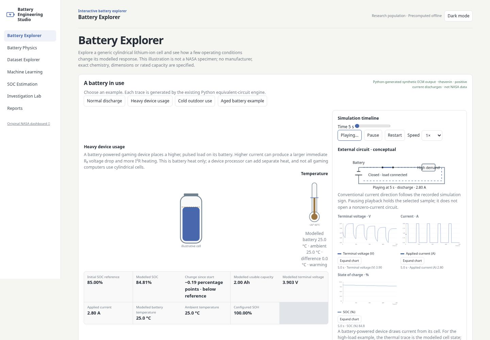
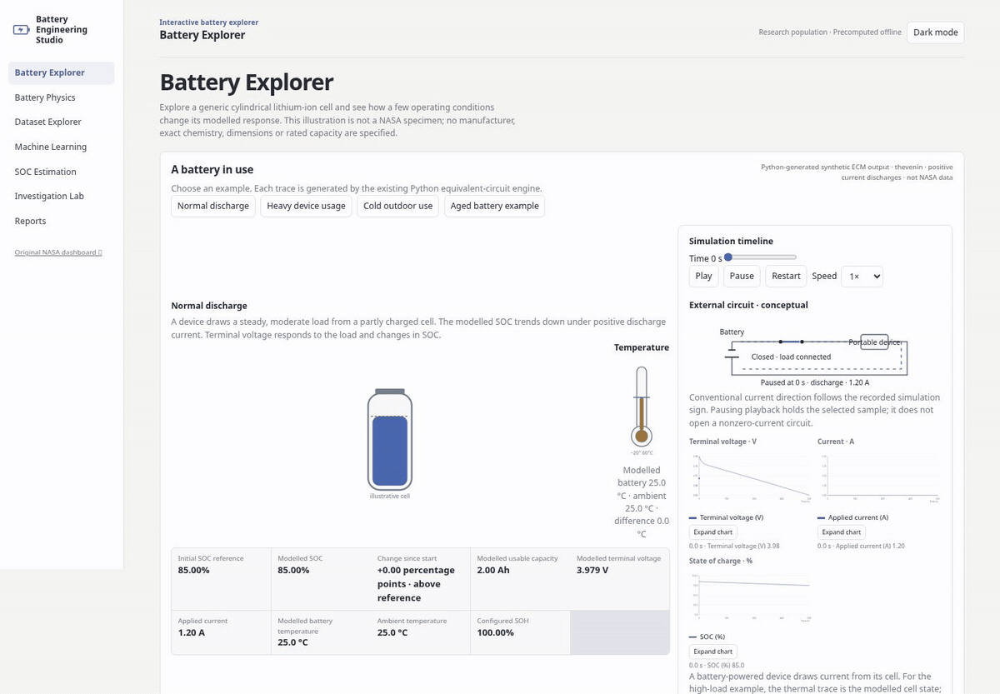
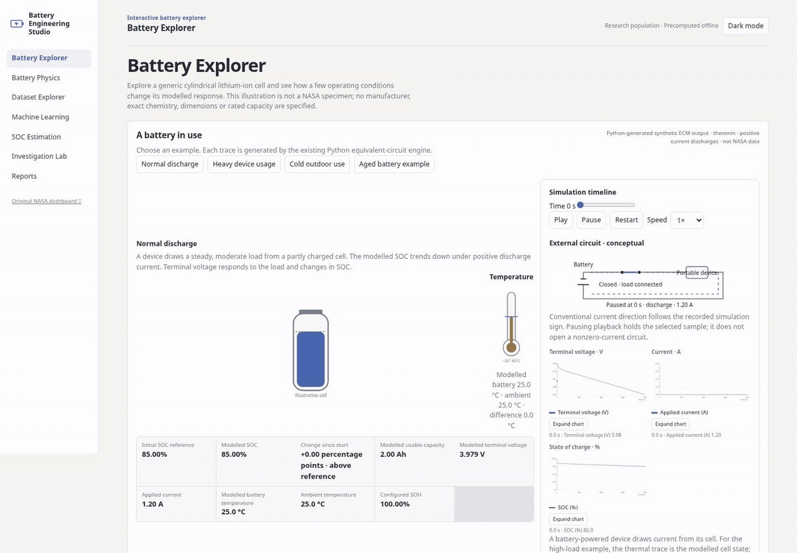
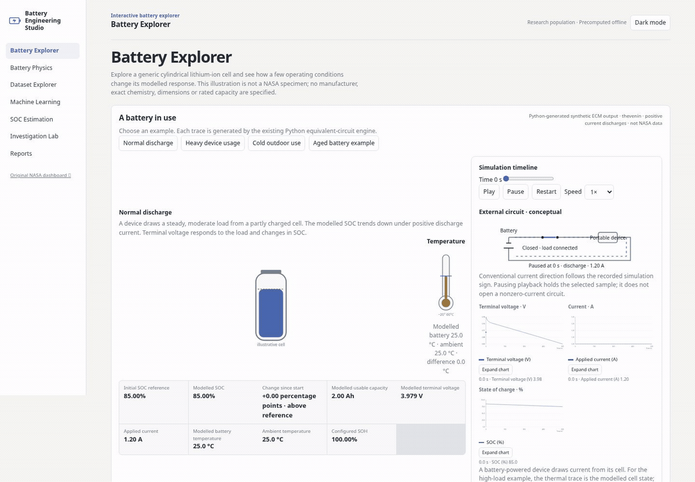
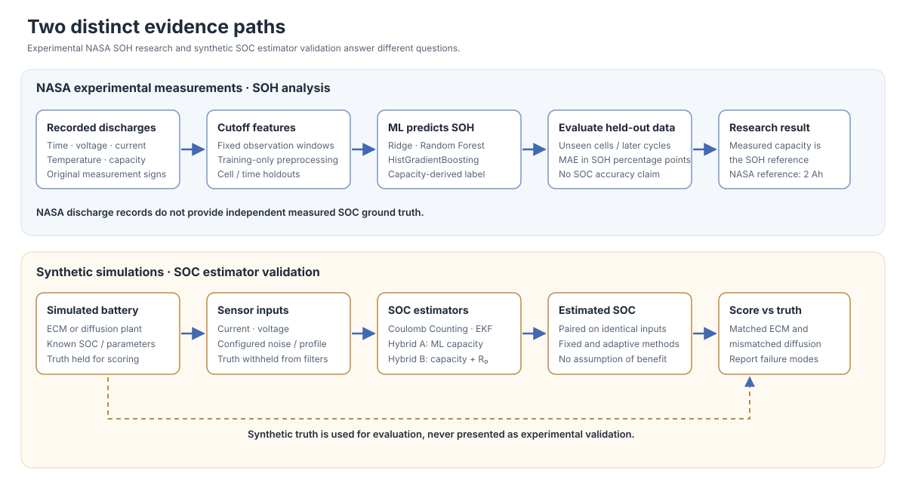
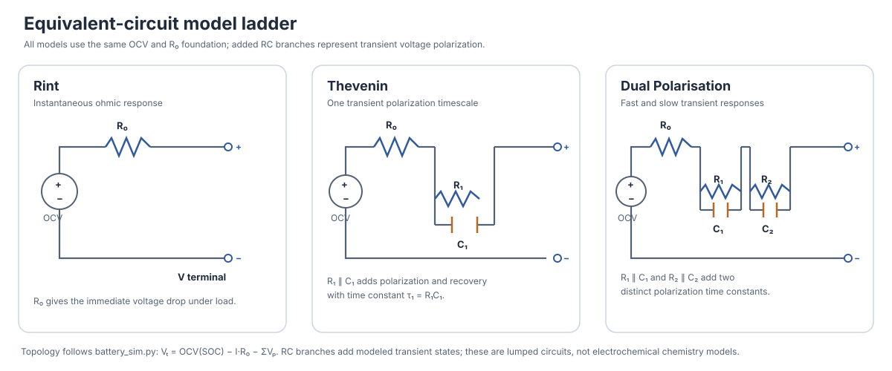

# Battery Engineering Studio

**Explore lithium-ion batteries through interactive physics simulations, machine learning and state estimation.**



[](https://www.python.org/)
[](https://numpy.org/)
[](https://scikit-learn.org/)

An offline-first engineering workbench built around a reproducible Python research project. Explore a procedural cell illustration, run equivalent-circuit simulations, and follow how battery measurements become SOH or SOC estimates. The interface is designed to explain the assumptions behind each result.

## What can you explore?

### Battery Explorer
Select an illustrative usage scenario and watch simulated SOC, voltage, current, temperature and the conceptual circuit update together. The dashed line marks initial SOC.



### Battery Physics
Run Rint, Thevenin or Dual Polarisation simulations with the shared Python engine. Compare voltage, current and SOC on a synchronized timeline.



### Battery Intelligence
Explore ML-based SOH predictions, step through Coulomb Counting and EKF SOC estimates, then inspect hybrid-estimator evidence and failure cases.



## How the evidence is evaluated

NASA experimental discharge measurements support capacity-derived SOH research. Separate synthetic experiments provide known SOC truth for estimator comparisons; simulated truth is never presented as experimental validation.



The circuit diagrams reflect the shared model implementation in `battery_sim.py`: Rint models OCV and R₀, Thevenin adds one R₁‖C₁ polarization branch, and Dual Polarisation adds R₂‖C₂ for another response timescale.



## Research highlights

- NASA battery records are used for measured discharge replay and capacity-based SOH. Ridge, Random Forest and HistGradientBoosting estimate SOH, not SOC.
- Coulomb Counting and EKF estimate SOC on synthetic trajectories. Hybrid A uses estimated capacity; Hybrid B adapts capacity and R₀.
- Hybrid results depend on the plant and operating profile. The safeguarded Hybrid B rejected every update on the independent final cohorts and tied fixed EKF; no universal hybrid improvement is claimed.

## Quick start

Requires Python 3.12. The full workbench starts the local Python simulation service and opens the browser interface.

```powershell
git clone https://github.com/AsherFerdinand/ev-battery-health-ml.git
cd ev-battery-health-ml
py -3.12 -m venv .venv
.\.venv\Scripts\python.exe -m pip install -r requirements-lock.txt
.\.venv\Scripts\python.exe build_workbench.py --full --port 8765
```

Cross-platform alternative after cloning and creating `.venv`:

```bash
python3.12 -m venv .venv
.venv/bin/python -m pip install -r requirements-lock.txt
.venv/bin/python build_workbench.py --full --port 8765
```

The first NASA data run needs internet access: run `pipeline.py` with the project environment to download and process the public archive. Raw datasets are not bundled. The workbench simulations and precomputed synthetic research views run locally.

## Documentation

- [v2.4 engineering report](docs/engineering-visualization-ux-v2.4.md) · [development roadmap](docs/workbench-roadmap.md)
- [Synthetic battery models and assumptions](docs/synthetic-battery.md) · [SOC workbench](docs/soc-workbench.md)
- [Independent hybrid validation and limitations](docs/robust-hybrid-v2.md) · [reproduction guide](docs/VERIFICATION.md)

## Limitations

NASA records do not contain independent SOC ground truth, so this project makes no experimental NASA SOC-accuracy claim. Synthetic validation scores estimators against simulated truth, not field measurements. Hybrid methods do not always improve results. CALCE is an optional external-data audit: its required thermal channels are unavailable in the inspected workbooks, so no compatible transfer metrics are claimed.
