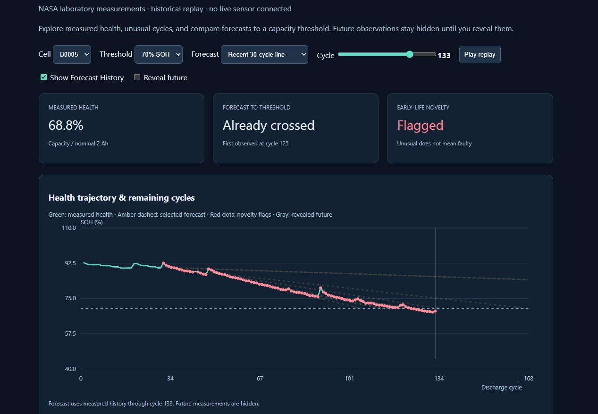
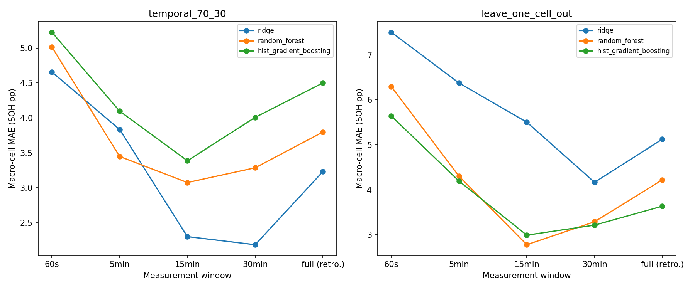
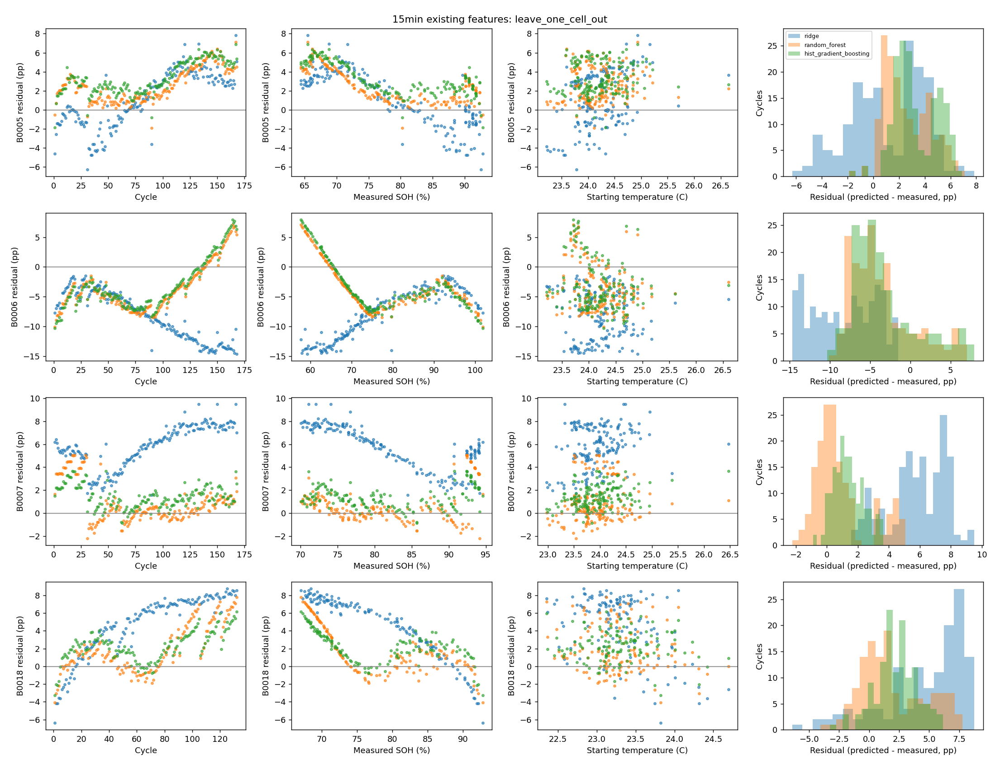
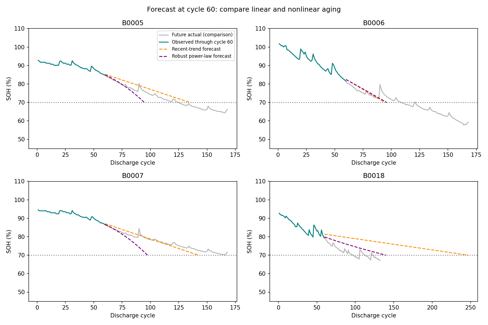

# EV Battery Health ML


**How much discharge data is needed to estimate battery health—and does the estimator transfer to another battery?**

A reproducible Python study of capacity-based state of health (SOH), cross-cell generalisation, degradation forecasting and measurement novelty. It combines real NASA ageing measurements with controlled experiments and an offline interactive dashboard.

**Key finding:** 15-minute measurements offer a useful research trade-off, but no tested estimator meets the MAE ≤5 SOH percentage-point screen on every battery in both evaluation tasks. This is a laboratory-data study, not a validated EV battery management or safety system.

### Interactive dashboard



*Actual dashboard capture: B0005 at cycle 133, with forecast history shown and future observations hidden. The 70% capacity threshold has already been crossed; a novelty flag is not a confirmed fault.*

The existing dashboard supports historical replay, model/window selection, measured versus predicted SOH and forecast history. It replays NASA records; it is not connected to live sensors.

## At a glance

- **Data:** 636 discharge cycles from NASA cells B0005, B0006, B0007 and B0018.
- **Estimators:** Ridge Regression, Random Forest and HistGradientBoosting.
- **Experiments:** 60-second, 5-, 15- and 30-minute windows; full-cycle signal summaries as a retrospective comparison.
- **Validation:** chronological later-cycle testing and nested leave-one-cell-out testing with training-only preprocessing and tuning.
- **Diagnostics:** per-cell MAE/RMSE/bias, residuals, controlled feature ablations, held-out permutation importance and explicit acceptance flags.
- **External-data investigation:** 51 CALCE workbooks inspected; unchanged model transfer rejected because required thermal measurements are unavailable.

## Workflow


The diagram summarises the SOH workflow. RUL uses completed-cycle measured capacity history, anomaly detection uses first-minute measurements, and external transfer has a separate measurement-compatibility gate.


Measured capacity defines the target: `SOH (%) = 100 × measured capacity (Ah) / nominal capacity (Ah)`. NASA uses **2 Ah** here. The ML estimate is a separate output. Capacity, full-cycle duration, cycle index and cell identity are excluded from model inputs.

## Verified model comparison

The following are **Phase 3 macro averages across batteries**, in **SOH percentage points (pp)**. They are not percentage accuracy. Both tasks use the same held-out membership across model comparisons, with protocol-appropriate inner tuning.

| 15-minute estimator | Feature set | Unseen-cell MAE | Later-cycle MAE | Worst cell/task MAE | Results over 5 pp, out of 8 |
|---|---|---:|---:|---:|---:|
| Random Forest | Existing 8 features | 2.78 | 3.07 | 5.05 | 1 |
| HistGradientBoosting | Existing + voltage drop/slope | 2.64 | 3.43 | 6.37 | 1 |
| Ridge Regression | Existing 8 features | 5.51 | 2.30 | 8.31 | 3 |

**Recommendation:** use the existing-feature Random Forest at 15 minutes as a provisional baseline balancing transfer and later-cycle performance. Retain the focused-feature gradient booster as a transfer-specific challenger and Ridge as a simpler known-cell reference. This is a task-dependent judgment, not an automatic ranking by overall MAE.

Random Forest still fails the later-cycle B0006 screen at **5.04646 pp**; that value is not rounded into a pass. No configuration passes every battery in both tasks. Doubling observation time to 30 minutes does not resolve that trade-off.

[Recommendation and reasoning](docs/results/phase3/recommendation.md) · [Full validation report](docs/results/phase3/validation_report.md) · [Per-cell MAE/RMSE](docs/results/phase3/cell_metrics.csv) · [Acceptance flags](docs/results/phase3/acceptance_flags.json)

### Why 15 minutes?

For the existing-feature Random Forest, 15 minutes gives unseen-cell MAE **2.78 pp** and later-cycle MAE **3.07 pp**. Thirty minutes doubles observation time while worsening these averages to **3.29 pp** in both tasks. Shorter windows transfer less consistently. Fifteen minutes is therefore a practical research trade-off, not a proven physical optimum or a guarantee that every battery passes.

### Why MAE is not percentage accuracy

MAE averages the absolute difference between predicted and measured SOH. Predicting 82% SOH when the reference is 80% produces a **2 percentage-point error**. An MAE of 2.78 pp does **not** mean 97.22% accuracy; `100 − MAE` is not a valid accuracy calculation.

### Measurement duration



Fifteen minutes exposes more discharge trajectory than the shortest windows, but improvement is not monotonic. The full-cycle column is retrospective ML on complete signal summaries; direct full-cycle capacity remains the reference measurement, not a zero-error ML predictor. All selected recordings support the requested windows, so the current common cohort contains all 636 cycles.

### Cross-cell failure analysis



Rows correspond to held-out batteries. Positive residual means overestimated health. B0006 is particularly difficult: late-life labels extend beyond other cells' training health range. Temperature correlations are confounded by cell, operating conditions and health; they do not establish why degradation occurs.

### Feature reliance, not causation

[View the held-out permutation-importance figure](docs/assets/permutation_importance.png)

A fixed-hyperparameter 2³ ablation adds voltage drop, voltage slope and temperature rise separately and jointly. Slope improves average cross-cell MAE in these controlled experiments. Temperature rise helps temporal tree models but slightly worsens average cross-cell errors. Voltage drop is a re-expression of existing endpoints, not new measured information.

Held-out permutation importance diagnoses fitted-model reliance. Correlated features, row shuffling, time dependence and unrealistic feature combinations limit interpretation; joint voltage/temperature permutations are also exported. **Neither permutation importance nor ablation establishes physical causation.** No discharge-derived resistance is invented from V/I or an uncharacterised current transition.

## Independent dataset compatibility

CALCE CS2_35 and CS2_36 contain 25 and 26 XLSX workbooks respectively. Every raw telemetry sheet was inspected. Voltage, current, elapsed time and capacity counters are present, but cell-temperature and ambient-temperature channels are absent. The Info-sheet `Temp` field is an auxiliary-channel mapping set to zero—not a measured 0°C value.

Both frozen estimators require starting temperature, temperature rise and ambient temperature. Consequently:

- **No CALCE model predictions, MAE/RMSE, bias or acceptance results are claimed.**
- No missing temperatures were fabricated or silently imputed.
- No reduced-feature or externally retrained model is presented as validation of the original models.
- A future NASA-trained voltage/current-only model would be a separately labelled transfer experiment.

[External-validation report](docs/results/phase4/external_validation_report.md) · [Workbook schema audit](docs/results/phase4/calce_workbook_schema.csv)

## Forecasting, uncertainty and anomaly detection



RUL forecasts project completed-cycle **measured capacity history** toward first recorded 70% or 80% SOH crossings. Recent linear, all-history linear and robust power-law curves are compared. They forecast discharge-cycle counts, not calendar dates or safety failures. Uncrossed trajectories are censored rather than assigned failure at the last observation.

Isolation Forest flags unusual first-minute measurements relative to early life. There are no verified fault labels: flags can reflect ageing or operating differences and are not confirmed defects.

[View the exploratory prediction-interval figure](docs/assets/uncertainty_intervals.png)

A separate calibration-cell experiment targeted 90% interval coverage. Average empirical coverage across cell/calibration pairs was about **71.7% for HGB**, **69.6% for RF** and **60.5% for Ridge**. These use separate fixed-configuration fits, not the tuned Phase 3 models. Dependence and cross-cell shift prevent a claim of reliable 90% coverage on new batteries. Four cells are insufficient to establish finite, distribution-free 90% cell-level calibration in the tested split design.

[Interval coverage and widths](docs/results/phase2/interval_metrics.csv)

## Run locally on Windows

Tested with **Python 3.12.14**. Install regular Python 3.12, then open PowerShell in the repository folder. No environment activation or execution-policy change is needed.

```powershell
py -3.12 -m venv .venv
.\.venv\Scripts\python.exe -m pip install -r requirements-lock.txt

# First run downloads NASA's public archive and builds the baseline reports.
.\.venv\Scripts\python.exe pipeline.py

# Compare measurement windows and build the offline dashboard.
.\.venv\Scripts\python.exe window_experiment.py
.\.venv\Scripts\python.exe build_dashboard.py
```

Open `reports/dashboard.html` in your browser. It provides historical replay, measured versus predicted SOH, model/window selectors, per-cell error information and optional RUL forecast history. It does **not** stream data from a physical battery. The HTML is generated locally rather than committed with its embedded dataset.

The first run needs internet access and disk space for the full NASA archive and dependencies. Once cached, use `pipeline.py --offline`. Raw datasets are downloaded/supplied separately; they are not bundled here.

### Reproduce the validation experiments

```powershell
.\.venv\Scripts\python.exe phase2.py
.\.venv\Scripts\python.exe phase3.py
.\.venv\Scripts\python.exe -m unittest discover -s tests

# Inspect the explicit acceptance screen; --strict exits 1 for any flagged result.
.\.venv\Scripts\python.exe phase3_acceptance.py --model random_forest --window 15min --feature-set base --strict
```

The strict command is **expected to exit 1** for the retained B0006 failure. That is scientific rejection, not a software-test failure.

**Publication-copy test status: 18 passed / 14 explicitly skipped (32 discovered).** The skipped tests require generated data, reports, frozen models or the CALCE audit; they are not counted as passed. The original complete research workspace previously passed all 32 checks.

To enable the integration checks, run `pipeline.py`, `window_experiment.py`, `build_dashboard.py`, `phase2.py` and `phase3.py` in that order, then the NASA-only freeze and CALCE inspection/audit commands below. Finally rerun `python -m unittest discover -s tests -v` in the project environment. NASA-only reproduction enables 28 checks; the remaining four require Phase 4 freeze/audit artifacts. Raw CALCE files must be obtained separately. This regenerates integration evidence, not missing temperature measurements or external predictions. See [the artifact-to-test guide](docs/VERIFICATION.md#regenerating-integration-artifacts).

`run.ps1` runs the NASA pipeline, all window/Phase 2/Phase 3 experiments and tests in order. Optional Node.js is needed only for `node tests/dashboard_smoke.cjs`, after dashboard generation. No Node packages are required.

### Reproduce the CALCE compatibility investigation

```powershell
# Freeze final models using NASA-only CV and training; reruns verify rather than refit.
.\.venv\Scripts\python.exe phase4_freeze.py

# Obtain the provider archives separately and place them in data/external/calce/.
.\.venv\Scripts\python.exe phase4_inspect.py data/external/calce/CS2_35.zip --output reports/phase4/CS2_35_inventory.json
.\.venv\Scripts\python.exe phase4_inspect.py data/external/calce/CS2_36.zip --output reports/phase4/CS2_36_inventory.json
.\.venv\Scripts\python.exe phase4_calce_audit.py
```

Phase 3 produced fold evaluations rather than a single final transfer model. The freeze step retains its selected recipes/features, chooses settings using NASA-only leave-one-cell-out CV, and refits on all four NASA cells before inspecting external performance. This is final NASA training, not CALCE adaptation. Artifact/source/data hashes enforce the freeze.

`phase4_evaluate.py` is a guarded runner for **reviewed compatible canonical data**, not a general CALCE parser. It rejects missing required channels and never fits or tunes. Do not mark compatibility verified merely to bypass the gate.

## Repository layout

```text
pipeline.py                  NASA ingestion, SOH baselines and novelty detection
window_experiment.py         Matched measurement-window comparison
forecast.py                  RUL baselines and backtests
build_dashboard.py           Offline dashboard generator
dashboard_template.html      Dashboard source
phase2.py                    Physics features, nested benchmark and interval study
phase3.py                    Matched model/window validation and controlled ablations
phase3_recommendation.py     Evidence synthesis and recommendation
phase3_acceptance.py         Explicit per-cell MAE acceptance gate
phase4_*.py                  Freeze, archive inspection and guarded transfer tooling
tests/                       Unit and artifact-dependent integration checks
docs/assets/                 Selected verified graphs
docs/results/                Curated result tables and reports from the completed study
requirements*.txt            Pinned direct and complete tested dependencies
run.ps1                      Reproduction entry point
```

`data/`, `reports/`, `models/`, environments and caches are generated locally and ignored. `docs/results/` contains intentionally selected publication evidence, not raw datasets. Original phase outputs are regenerated under `reports/`; public snapshot documents under `docs/` are not automatically overwritten.

## Engineering FAQs

<details>
<summary>What does SOH mean here?</summary>

Capacity relative to nominal rating. NASA uses 2 Ah. A different dataset needs its documented rating; changing the label divisor is not permission to change the frozen model's input features.

</details>

<details>
<summary>Why not randomly split individual cycles?</summary>

Adjacent cycles from one battery are strongly related. Random cycle splits can overstate transfer to unseen batteries. This study separates whole batteries for cross-cell evaluation and preserves chronology for later-cycle prediction.

</details>

<details>
<summary>Are all historical predictions free of future data?</summary>

Features stop at the selected measurement cutoff. Later-cycle models train/tune only on training prefixes; unseen-cell models use other batteries. RUL snapshots fit only completed-cycle history through their own origin. Whole-fold MAE displayed by the dashboard is retrospective evaluation information and does not feed predictions. Leave-one-cell-out is retrospective cross-cell transfer, not chronological fleet forecasting.

</details>

<details>
<summary>Why not choose the lowest average error?</summary>

A good pooled score can conceal an unacceptable battery. The recommendation weighs per-cell errors, worst-case consistency, both prediction tasks, observation time and model complexity. It retains explicit failures.

</details>

<details>
<summary>Does a novelty flag reveal a faulty battery?</summary>

No. There are no labelled faults, and ordinary ageing or operating changes can look novel.

</details>

<details>
<summary>Does a threshold crossing mean the battery breaks?</summary>

No. Seventy/eighty percent is a capacity criterion, not a predicted safety incident or sudden failure.

</details>

<details>
<summary>Why not fill CALCE temperature with a typical room temperature?</summary>

Ambient and cell temperature are different measurements; temperature rise is a model input. A guessed constant would silently change the experiment and conceal missing information.

</details>

<details>
<summary>Is the project validated on another dataset?</summary>

The independent CALCE archives were inspected, but direct inference was stopped at the compatibility gate. No external performance claim is made.

</details>

<details>
<summary>Can this be used in an EV?</summary>

Not on the basis of these results. Pack behaviour, chemistries, field duty cycles, sensor quality, uncertainty, safety and deployment constraints require appropriate independent validation.

</details>

## Limitations and next experiments

Only four NASA cells underpin model development, and they have been examined repeatedly. Nested validation prevents direct fold leakage but does not erase researcher selection. Hyperparameter grids are small; no population confidence interval, calibrated new-cell uncertainty or latency/memory benchmark is claimed. Thermal associations and feature importance do not identify degradation mechanisms.

Next: freeze the provisional baseline/challenger and evaluate compatible untouched batteries; alternatively define a separate reduced-feature NASA-to-CALCE experiment before inspecting its performance. Keep external adaptation and direct transfer results distinct.

## Data provenance and attribution

- **NASA:** B. Saha and K. Goebel (2007), *Battery Data Set*, NASA Ames Prognostics Data Repository. [Provider repository](https://www.nasa.gov/intelligent-systems-division/discovery-and-systems-health/pcoe/pcoe-data-set-repository/). Raw archives, original metadata and file hashes are retained locally by the ingestion pipeline.
- **CALCE:** [University of Maryland battery data](https://calce.umd.edu/data). Archives were obtained from the provider and inspected locally. Consult and cite the provider's relevant experiment papers when publishing work based on its data. No CALCE raw data is redistributed here.

Original project code is licensed under the [MIT licence](LICENSE). The grant does not cover third-party datasets, measurements, dependencies, logos or other third-party materials. See [licensing scope and attribution](LICENSE_NOTES.md). Badges are static project metadata, not live CI or certification claims.

## Workbench development roadmap

v1.1 adds a separate offline synthetic battery workbench with Rint, Thevenin and Dual Polarisation circuits, plus a finite-volume diffusion model for testing under structural mismatch. Generate the default pulse datasets with `.venv/bin/python synthetic_battery.py` on Linux or `.\.venv\Scripts\python.exe synthetic_battery.py` in PowerShell. The generator writes compressed, seeded datasets to `data/synthetic/`, separate from NASA experimental data.

See the [synthetic modelling report](docs/synthetic-battery.md) for conventions, reproduction commands and verification. The [workbench roadmap](docs/workbench-roadmap.md) covers future SOC EKF and hybrid estimator comparisons, independent validation, and the educational interface.

### SOC workbench v1.2–v1.3

Launch the offline educational workbench with `.venv/bin/python build_workbench.py` on Linux or `.\.venv\Scripts\python.exe build_workbench.py` in PowerShell. Explore the cell cutaway, NASA and synthetic traces, equivalent circuits, capacity models, EKF diagnostics and Hybrid A. The browser plays precomputed Python results.

The synthetic comparison found that a better capacity estimate could still increase SOC error. See the [SOC workbench report](docs/soc-workbench.md) for the full results and reproduction commands.

### Hybrid B visual workbench v1.4–v1.5

The same offline launch now compares Hybrid B with the v1.3 estimators. Explore its causal capacity and ohmic-resistance updates, representative trained-model traces, synchronized EKF equations and directional ion flow. Run `build_workbench.py --full --no-open` with the project Python to regenerate the complete synthetic comparison, including the separate RC stress cohort. [Engineering report](docs/hybrid-b-workbench.md)
