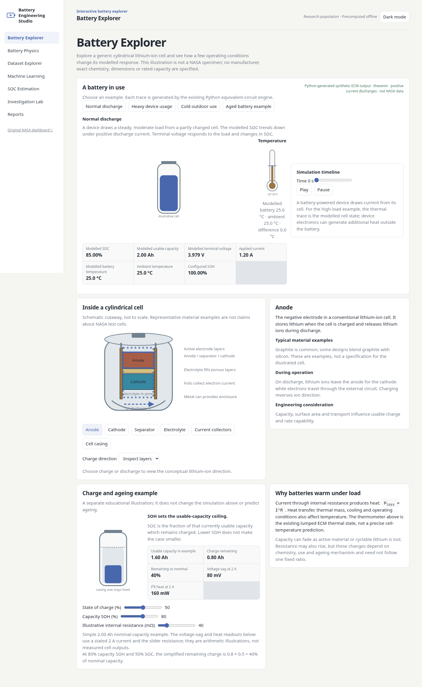
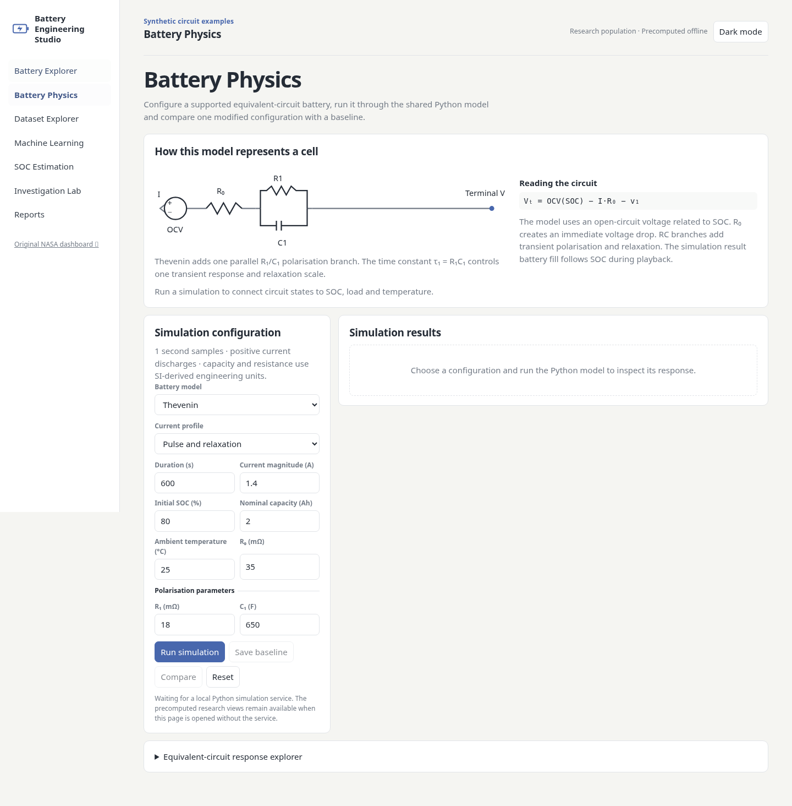
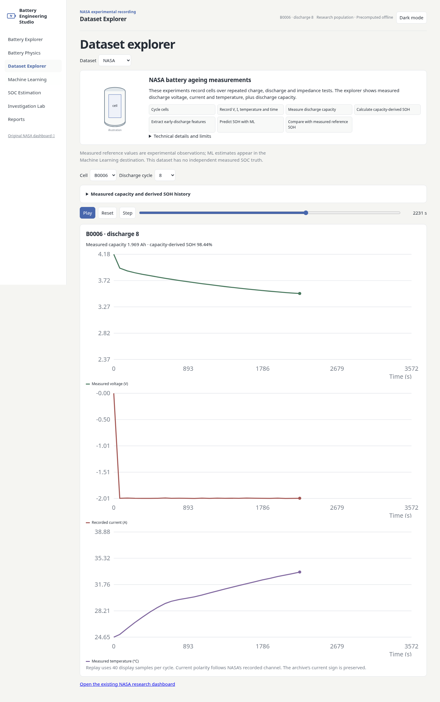

# Battery Engineering Studio v2.3 — Interactive Battery Explorer

**Branch:** `feature/battery-explorer-educational-v2.3`

**Base:** v2.2 commit `ad33b41`

**Environment measured:** managed Linux Cloud Codex, Python 3.12 and Chromium, 2026-11-21.

## What changed

The landing page merges the former Overview and Battery Design destinations into **Battery Explorer**. The redundant workflow ribbon, four shortcut cards and repeated introduction were removed. Seven destinations remain: Battery Explorer, Battery Physics, Dataset Explorer, Machine Learning, SOC Estimation, Investigation Lab and Reports.

Explorer includes four short operating examples: normal discharge, high load, cold ambient and a configured aged-cell case. Each measurement trace comes from the existing Python ECM API. They are synthetic teaching presets, not new cohorts, validated research results or NASA observations. The scenarios use the Thevenin engine and a local 1 Hz profile. Heavy load uses 2.8 A and shows voltage response and I²R thermal response; device-processor heat is called out as separate. Cold use sets ambient to −5 °C and shows the existing temperature-dependent R₀ response; it does not add cold-related capacity fade. The aged example configures SOH 0.8 and R₀ 0.05 Ω independently. This changes the existing Cell capacity used by SOC integration and illustrates voltage sag; it is not a cycle-ageing model or a universal relationship between capacity and resistance. If the service is unavailable, no scenario measurements are fabricated; the page tells the user how to start the local studio.

The loopback simulation API adds an optional `soh` configuration (0.5–1.0, default 1.0) and reports the engine's `soh` and available capacity channels, in schema version 2. Existing v2.2 configurations retain their default 100% SOH behavior. No ECM equations or defaults were changed. Voltage, SOC, available capacity, current and modelled kelvin temperature feed the Explorer's readouts, charge fill and thermometer. The thermometer compares ambient and battery temperature and estimates trend over a 30-second interval. Temperature remains a simple lumped ECM state, not a precise cell-temperature prediction.

The cylindrical cell visual remains generic. It has no asserted manufacturer, dimensions, rated voltage, capacity or exact chemistry. The cutaway supports hover, pointer selection, keyboard activation, labels, charge/discharge ion direction and representative material explanations for the anode, cathode, separator, electrolyte, collectors and casing. Those material examples are not attributed to NASA. Reduced-motion preferences shorten or suppress animation. A separate fixed-casing SOC/SOH diagram distinguishes currently usable capacity from charge remaining: at 80% SOH and 50% SOC it shows 1.6 Ah available and 0.8 Ah remaining for its stated illustrative 2 Ah nominal reference (40% of nominal). Its resistance sag/heat controls are explicitly arithmetic illustrations, separate from the simulations and validated ageing predictions.

Battery Physics keeps the v2.2 Simulation Lab. Its circuit SVG responds to the selected Rint, Thevenin or Dual Polarisation model and focuses corresponding input controls on mouse or keyboard interaction. The diagram explains immediate R₀ sag, RC transient response and fast/slow polarisation. Simulation playback updates its SOC illustration and accessible status. The legacy precomputed circuit-response explorer remains available.

Dataset Explorer now opens on NASA. It introduces the charge/discharge/test cycle, recorded voltage/current/temperature/time, measured discharge capacity, capacity-derived SOH, ML feature/prediction steps and evaluation against the reference. Capacity/SOH histories are derived only from the existing local discharge data. The four cells remain B0005, B0006, B0007 and B0018, with cell/cycle selection and trace playback intact. The drawing is generic, with no claim about NASA specimen identity or dimensions. The project uses measured capacity divided by its 2 Ah reference for SOH; that is not asserted as a manufacturer's rating. NASA records do not provide independent measured SOC ground truth. Synthetic datasets remain available from the selector.

No estimator equations, training, saved scientific scores, validation cohorts, NASA measurements, exported estimator traces or v2.0 conclusions were modified. The original NASA dashboard remains a separate route. No dependency was added; the app remains local/offline after project setup.

## Reproduction

Windows PowerShell, after Python 3.12 and the locked dependencies are installed:

```powershell
py -3.12 -m venv .venv
.\.venv\Scripts\python.exe -m pip install -r requirements-lock.txt
.\.venv\Scripts\python.exe build_workbench.py --full --no-open --refresh
.\.venv\Scripts\python.exe build_workbench.py --full --port 8765
```

The last command serves the generated workbench and loopback simulation API and opens the browser. Linux Cloud Codex equivalents:

```sh
.venv/bin/python build_workbench.py --full --no-open --refresh
.venv/bin/python -m unittest tests.test_simulation_api -v
.venv/bin/python -m unittest discover -s tests -v
node tests/workbench_smoke.cjs reports/workbench-full.html
node tests/dashboard_smoke.cjs
```

## Verification

- Python regression: **69 passed, 1 skipped, 0 failed**. The optional skip is `test_downloaded_calce_thermal_schema_gate`; its authentic external archive/audit inputs are not present. This limitation is unchanged.
- Simulation/API suite: **8 passed**, including configured SOH capacity/SOC behavior and endpoint origin/schema/body validation.
- Quick and full workbench exports regenerated at **5,805,161 bytes** and **5,800,768 bytes**, respectively. Workbench structural checks passed for 21 paired trace sets and 63 circuit examples in both. The existing NASA dashboard smoke passed 288 cell/threshold/cycle/reveal cases plus 384 SOH/RUL cases and replay checks. The saved estimator results were not regenerated or modified.
- Full-export Chromium flow passed all seven destinations, all four API-backed scenarios, SOC and thermal playback, cutaway pointer and keyboard selection, reduced-motion behavior, SOC/SOH fill arithmetic, desktop and 390 px responsive layout, light/dark theme, physics model/parameter matching and the existing Python Simulation Lab. It verified NASA-first selection, B0005/B0006 cycle replay and the synthetic selector. The no-service path retained research views and gave the Explorer a clear unavailable-data message. There were no page errors or external requests.
- Five browser navigation samples were 575, 357, 380, 189 and 221 ms (median **357 ms**). Fifty synchronous legacy playback renders measured **2.5 ms median, 3.5 ms p95, 3.7 ms maximum**. These are Cloud Chromium measurements, not Windows desktop results.
- Browser aggregate idle PSS was 476.2 MiB vs a 213.3 MiB blank-browser baseline: **262.9 MiB attributable delta** for that Cloud run. CPU time increased 0.220 CPU-seconds over 2.5 seconds idle. v2.2 recorded 269.6 MiB by the same browser-process method; this run was 6.7 MiB lower, a small difference within observed run-to-run variation and still above the preliminary 200 MiB target. These aggregate multi-process figures are not application-only Python memory.
- The working repository excluding `.venv`, raw data and generated reports was **7.7 MB**; the existing Git object store was **2.35 MiB**. Three representative full-page Chromium screenshots total **744 KiB** and are included below; they are documentation images, not application inputs. The inherited `.venv` footprint was **459 MiB**. No runtime dependency was added, so there is no v2.3-attributable install delta. Simulation trajectories are generated on demand and no dataset artifact is committed. Full HTML remains about 5.8 MB, above the aspirational 5 MB asset target because it embeds the existing research payload.

### Battery Explorer



### Battery Physics



### NASA Dataset Explorer


