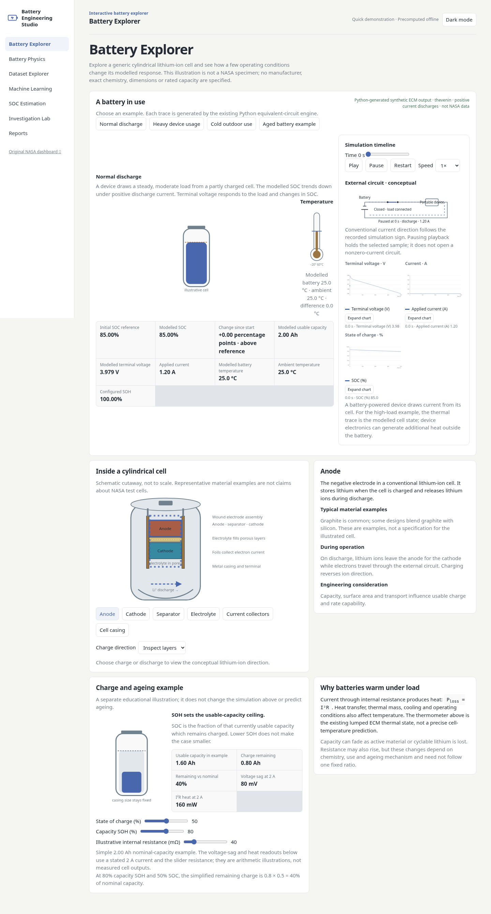
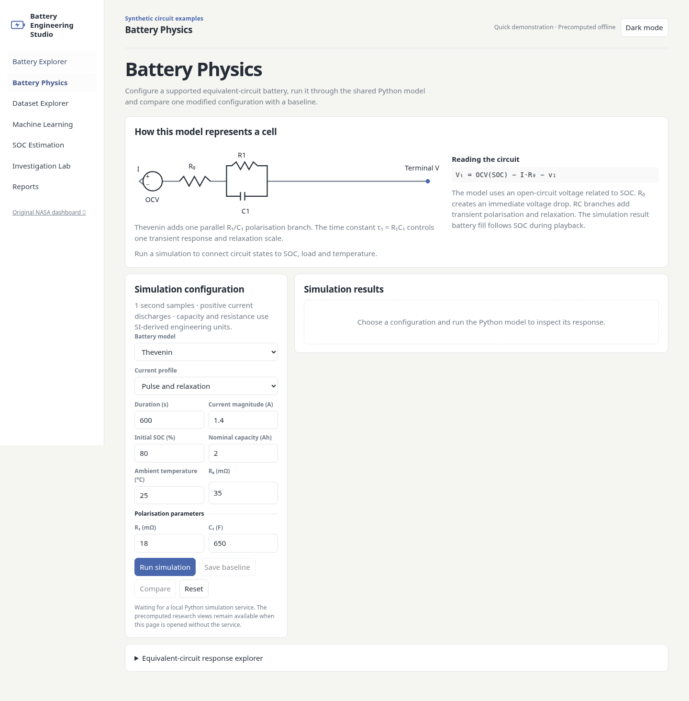
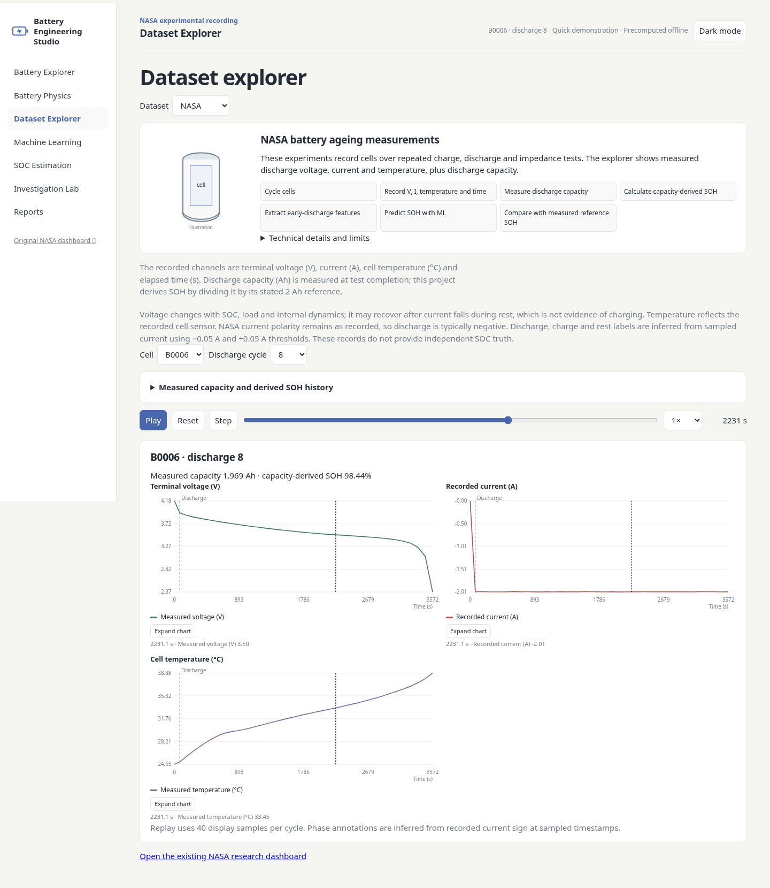

# v2.4 Interactive Engineering Visualisation & Learning Report

**Branch:** `feature/engineering-visualization-ux-v2.4`
**Base:** v2.3 `ab90427`
**Scope:** frontend-first learning and visualization improvements. No estimator or model retraining changes.

## What changed

- One shared playback clock and timer now synchronize research traces, NASA replay, the Battery Explorer, ECM comparisons and the Simulation Lab. Changing views pauses playback. Trace data remains full precision; static chart geometry is cached and only sample cursors/readouts move during playback. Display-only curve decimation is bounded to 600 points.
- The Explorer synchronizes terminal voltage, current and SOC at one sample. Initial SOC remains visible as a ghost reference, current flow direction and intensity follow the selected input, and the schematic is described as conceptual. Three compact trajectory charts can expand for inspection.
- Battery Physics explains the purpose and assumptions of Rint, Thevenin and Dual Polarisation using beginner language with expandable technical details. All three voltage responses share the same profile, time axis and playback cursor. Users can show terminal voltage or voltage deviation from OCV.
- NASA Dataset Explorer explains what is measured, where capacity-derived SOH comes from and why the archive does not provide independent SOC ground truth. Phase labels are inferred from sampled current (`|I| < 0.05 A` rest; negative-current charge; positive-current discharge); this is a visualization heuristic, not protocol metadata. Original measurement signs are preserved.
- Machine Learning explains Ridge, Random Forest and HistGradientBoosting, labels axes and units on the prediction surface, identifies features held at training medians, and explains the marginal feature range and joint-support limitation. SOH prediction is explicitly distinguished from SOC estimation.
- SOC Estimation describes Coulomb Counting, fixed EKF and Hybrid A/B, plus the five EKF steps. Investigation Lab gives a plain-language account of the independent validation and why the safeguard did not show an advantage over fixed EKF.

## Scientific boundary and implementation

Python remains the source of numerical simulation and validated outputs. `build_workbench.py` now exports the simulation's existing `current_a` input alongside the already exported ECM trajectories so the three models can be compared against identical excitation. This is data plumbing only: battery equations, estimator equations, trained models, cohort membership, NASA measurements and saved Phase 1–4 results were not altered. NASA observations and synthetic simulations remain separately labelled. No dependency was added; the UI uses existing HTML/CSS/JavaScript/SVG.

The conceptual circuit, cutaway and current-flow animation are teaching visuals, not chemistry-specific or validated electrochemical geometry. NASA phase classification is approximate. The displayed ML surface varies two features and fixes the remaining features at training medians; points on that surface can fall outside the joint training-data support. These views do not provide measured SOC for NASA cells or establish a validated BMS.

## Verification

- `python -m unittest discover -s tests -v`: **69 passed, 1 optional CALCE audit skipped, 0 failed**. The skip is due to the external archive audit prerequisite.
- `python -m unittest tests.test_simulation_api -v`: **8 passed**.
- `node tests/workbench_smoke.cjs reports/workbench-full.html`: preserves the paired trajectories and ECM examples.
- `node tests/dashboard_smoke.cjs`: original NASA dashboard replay/history checks.
- `REQUIRE_ROBUST=1 REQUIRE_HYBRID_B=1 CHROMIUM_PATH=/usr/bin/chromium node tests/workbench_browser.cjs http://127.0.0.1:<port>/`: full-export Chromium acceptance passed all seven views, offline request blocking, playback, model explanations, dataset/model/SOC/Investigation Lab checks, simulation interactions and responsive layout. The browser server is the regular `python build_workbench.py --full --port <port>` loopback launcher. Browser run generated the three screenshots below. `git diff --check` and `node --check tests/workbench_browser.cjs` also passed.

### Selected screenshots







## Performance and footprint measurements

These are managed Linux Cloud measurements, not Windows desktop benchmarks. Browser measurements used `/usr/bin/chromium`, the full embedded export and the repository's Playwright browser harness. Five page-navigation wall measurements were 582, 424, 359, 217 and 275 ms (median **359 ms**). After a 2.5 second idle period, Chromium process aggregate PSS was 367.7 MiB versus a 217.4 MiB blank-browser baseline: attributable delta **150.3 MiB**. Aggregate process CPU over the idle interval was **0.230 CPU-seconds**. Fifty synchronous playback render calls measured median **0.9 ms**, p95/max **1.1 ms**. This is a focused render benchmark, not a full end-to-end frame-rate guarantee.

The full generated HTML is **5,824,378 bytes** and is ignored rather than committed. The three reviewed screenshots total **830,003 bytes**. The final tracked repository contains 95 files / 4,011,627 bytes, including these screenshots and the report (`git ls-files -z | xargs -0 du -cb`). The existing `.venv` was 459 MiB; v2.4 adds **zero dependencies**, so that environment size is not an attributable increase. No synthetic dataset archive is committed. A separate 1,801-sample Dual Polarisation configuration completed in 18.1 ms in this cloud environment; this is a local simulation-call measurement, not a Windows benchmark.

Startup, memory and CPU measurements depend on the managed environment and browser. The idle memory delta is below the project's preliminary 200 MiB attributable target for this browser configuration. Repository size and visual asset size are approximate tracking checks, not runtime measures.

## Reproduction

```bash
python -m unittest discover -s tests -v
python -m unittest tests.test_simulation_api -v
python build_workbench.py --full --no-open --refresh
node tests/workbench_smoke.cjs reports/workbench-full.html
node tests/dashboard_smoke.cjs
```

For interactive acceptance, start `python build_workbench.py --full --port 8766` and run the browser command above against `http://127.0.0.1:8766/`. The generated page and application operate locally with no external frontend requests.
