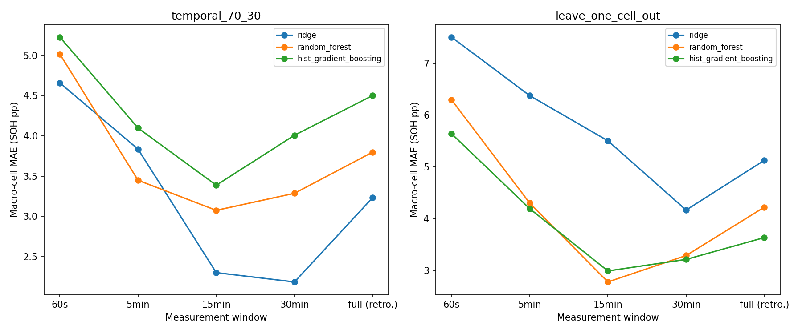
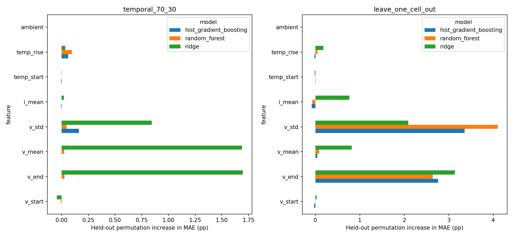
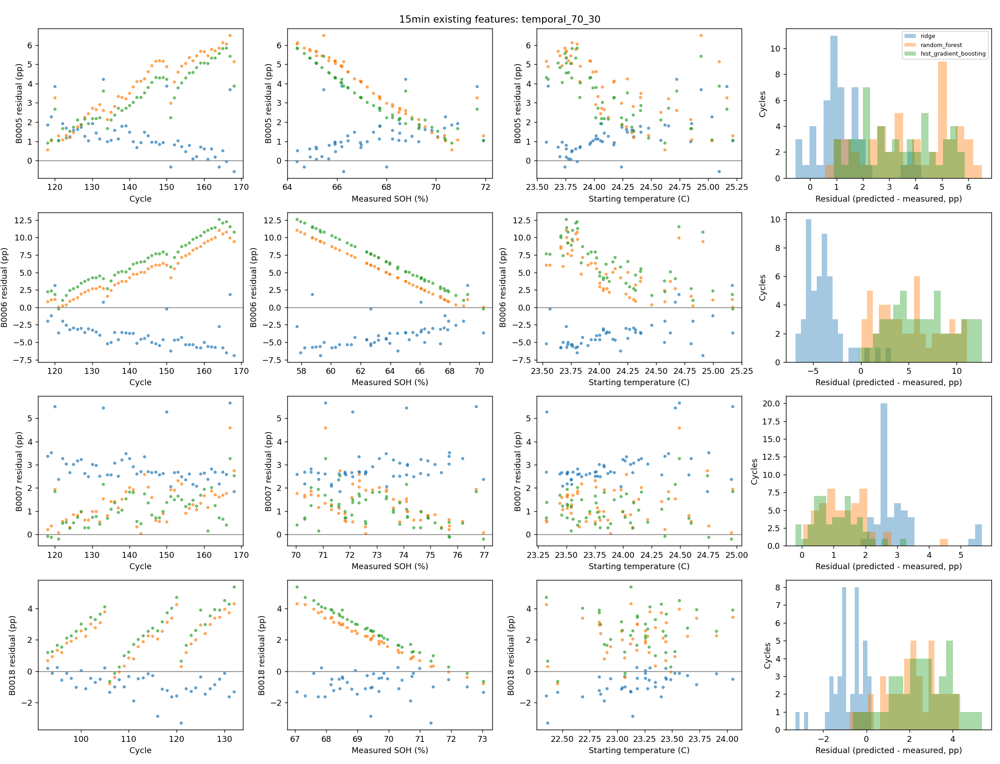
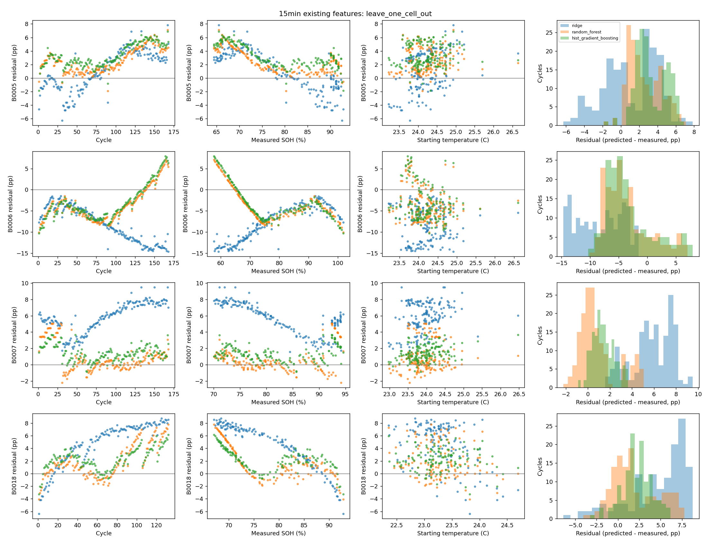

# Phase 3 engineering validation report

## Reproduce and scope

Run `python phase3.py` in the existing environment, then `python -m unittest discover -s tests`. No new dependencies, network or UI changes. Seeds/configurations/raw hashes/software versions are in manifest.json; exact fit, test and inner-validation keys are in split_tuning_audit.json. Existing dashboard, RUL, anomaly detection and previous experiments are preserved.

This is continued exploratory analysis of the same four NASA cells, not independent dataset confirmation. Target SOH is measured Capacity / nominal 2 Ah ×100; ML outputs estimate this label. Full-cycle ML is retrospective and not a replacement for directly measuring capacity; it is excluded from early-window recommendations.

## Matched evaluation and tuning

Original 70/30 chronological per-cell membership and four leave-one-cell-out folds are reused identically for all models/windows. Common complete-case cycles across all windows are selected before fitting and count is saved in the manifest. All recorded selected cells span the requested windows here; changing this filter can bias another dataset toward longer-lasting discharges.

For later-cycle evaluation, tuning splits only the outer training prefixes into first 70%/last 30% per cell. For unseen-cell evaluation, tuning uses inner leave-one-cell-out on the three outer training cells, optimizing macro-cell MAE. Every imputer/scaler is fitted inside its training pipeline. Two preset candidates per model, no test-driven early stopping, no target/cycle/cell/duration in inputs. Different protocol-specific tuning is appropriate to the intended prediction task, so a deployed model needs its intended protocol stated. The small tuning grid is not exhaustive optimization.

## Model and window comparison

MAE/RMSE are SOH percentage points, not percentage accuracy. Macro means weight each battery equally. Worst-cell error and acceptance failures are primary checks alongside the mean. No confidence interval for population performance is claimed from four cells.

| experiment | window | protocol | feature_set | model | macro_cell_mae_pp | worst_cell_mae_pp | macro_cell_rmse_pp | flagged_cells |
|---|---|---|---|---|---|---|---|---|
| benchmark | 15min | leave_one_cell_out | base | hist_gradient_boosting | 2.992 | 4.758 | 3.369 | 0 |
| benchmark | 15min | leave_one_cell_out | base | random_forest | 2.779 | 4.779 | 3.398 | 0 |
| benchmark | 15min | leave_one_cell_out | base | ridge | 5.505 | 8.308 | 6.048 | 3 |
| benchmark | 15min | leave_one_cell_out | focused | hist_gradient_boosting | 2.638 | 4.64 | 2.968 | 0 |
| benchmark | 15min | leave_one_cell_out | focused | random_forest | 2.719 | 4.689 | 3.224 | 0 |
| benchmark | 15min | leave_one_cell_out | focused | ridge | 4.616 | 7.284 | 5.162 | 1 |
| benchmark | 15min | temporal_70_30 | base | hist_gradient_boosting | 3.386 | 6.496 | 3.779 | 1 |
| benchmark | 15min | temporal_70_30 | base | random_forest | 3.075 | 5.046 | 3.523 | 1 |
| benchmark | 15min | temporal_70_30 | base | ridge | 2.3 | 4.102 | 2.531 | 0 |
| benchmark | 15min | temporal_70_30 | focused | hist_gradient_boosting | 3.426 | 6.372 | 3.851 | 1 |
| benchmark | 15min | temporal_70_30 | focused | random_forest | 3.119 | 5.068 | 3.571 | 1 |
| benchmark | 15min | temporal_70_30 | focused | ridge | 2.261 | 4.256 | 2.453 | 0 |
| benchmark | 30min | leave_one_cell_out | base | hist_gradient_boosting | 3.214 | 4.476 | 3.571 | 0 |
| benchmark | 30min | leave_one_cell_out | base | random_forest | 3.289 | 4.643 | 3.832 | 0 |
| benchmark | 30min | leave_one_cell_out | base | ridge | 4.167 | 7.051 | 4.661 | 1 |
| benchmark | 30min | temporal_70_30 | base | hist_gradient_boosting | 4.008 | 6.914 | 4.475 | 1 |
| benchmark | 30min | temporal_70_30 | base | random_forest | 3.286 | 5.024 | 3.761 | 1 |
| benchmark | 30min | temporal_70_30 | base | ridge | 2.184 | 3.488 | 2.405 | 0 |
| benchmark | 5min | leave_one_cell_out | base | hist_gradient_boosting | 4.194 | 5.735 | 4.886 | 2 |
| benchmark | 5min | leave_one_cell_out | base | random_forest | 4.302 | 6.81 | 5.034 | 2 |
| benchmark | 5min | leave_one_cell_out | base | ridge | 6.377 | 9.746 | 7.083 | 3 |
| benchmark | 5min | temporal_70_30 | base | hist_gradient_boosting | 4.098 | 6.774 | 4.526 | 1 |
| benchmark | 5min | temporal_70_30 | base | random_forest | 3.448 | 5.05 | 3.907 | 1 |
| benchmark | 5min | temporal_70_30 | base | ridge | 3.835 | 6.351 | 4.178 | 1 |
| benchmark | 60s | leave_one_cell_out | base | hist_gradient_boosting | 5.643 | 7.552 | 6.61 | 3 |
| benchmark | 60s | leave_one_cell_out | base | random_forest | 6.298 | 10.148 | 7.487 | 3 |
| benchmark | 60s | leave_one_cell_out | base | ridge | 7.508 | 14.952 | 8.337 | 2 |
| benchmark | 60s | temporal_70_30 | base | hist_gradient_boosting | 5.228 | 8.283 | 5.673 | 2 |
| benchmark | 60s | temporal_70_30 | base | random_forest | 5.017 | 8.653 | 5.592 | 2 |
| benchmark | 60s | temporal_70_30 | base | ridge | 4.658 | 6.751 | 4.827 | 1 |
| benchmark | full | leave_one_cell_out | base | hist_gradient_boosting | 3.636 | 5.138 | 4.223 | 1 |
| benchmark | full | leave_one_cell_out | base | random_forest | 4.223 | 6.069 | 4.832 | 1 |
| benchmark | full | leave_one_cell_out | base | ridge | 5.128 | 9.836 | 5.87 | 1 |
| benchmark | full | temporal_70_30 | base | hist_gradient_boosting | 4.502 | 6.234 | 4.987 | 1 |
| benchmark | full | temporal_70_30 | base | random_forest | 3.798 | 5.077 | 4.258 | 1 |
| benchmark | full | temporal_70_30 | base | ridge | 3.232 | 5.576 | 3.474 | 1 |

## Per-cell results (benchmark)

| experiment | window | protocol | feature_set | model | cell | n | mae_pp | bias_pp | rmse_pp | max_error_pp | flag_mae_gt5 |
|---|---|---|---|---|---|---|---|---|---|---|---|
| benchmark | 15min | leave_one_cell_out | base | hist_gradient_boosting | B0005 | 168 | 3.354 | 3.316 | 3.71 | 6.903 | False |
| benchmark | 15min | leave_one_cell_out | base | hist_gradient_boosting | B0006 | 168 | 4.758 | -3.244 | 5.245 | 10.338 | False |
| benchmark | 15min | leave_one_cell_out | base | hist_gradient_boosting | B0007 | 168 | 1.435 | 1.406 | 1.7 | 3.653 | False |
| benchmark | 15min | leave_one_cell_out | base | hist_gradient_boosting | B0018 | 132 | 2.419 | 2.228 | 2.822 | 6.152 | False |
| benchmark | 15min | leave_one_cell_out | base | random_forest | B0005 | 168 | 2.602 | 2.565 | 3.109 | 7.101 | False |
| benchmark | 15min | leave_one_cell_out | base | random_forest | B0006 | 168 | 4.779 | -3.61 | 5.293 | 10.099 | False |
| benchmark | 15min | leave_one_cell_out | base | random_forest | B0007 | 168 | 1.294 | 0.873 | 1.917 | 5.054 | False |
| benchmark | 15min | leave_one_cell_out | base | random_forest | B0018 | 132 | 2.441 | 1.912 | 3.274 | 7.778 | False |
| benchmark | 15min | leave_one_cell_out | base | ridge | B0005 | 168 | 2.614 | 1.159 | 3.102 | 7.849 | False |
| benchmark | 15min | leave_one_cell_out | base | ridge | B0006 | 168 | 8.308 | -8.308 | 9.186 | 14.648 | True |
| benchmark | 15min | leave_one_cell_out | base | ridge | B0007 | 168 | 5.805 | 5.805 | 6.089 | 9.507 | True |
| benchmark | 15min | leave_one_cell_out | base | ridge | B0018 | 132 | 5.296 | 4.706 | 5.817 | 8.754 | True |
| benchmark | 15min | leave_one_cell_out | focused | hist_gradient_boosting | B0005 | 168 | 2.967 | 2.924 | 3.243 | 6.523 | False |
| benchmark | 15min | leave_one_cell_out | focused | hist_gradient_boosting | B0006 | 168 | 4.64 | -3.106 | 5.132 | 10.33 | False |
| benchmark | 15min | leave_one_cell_out | focused | hist_gradient_boosting | B0007 | 168 | 0.779 | 0.003 | 0.992 | 4.301 | False |
| benchmark | 15min | leave_one_cell_out | focused | hist_gradient_boosting | B0018 | 132 | 2.167 | 2.094 | 2.505 | 5.109 | False |
| benchmark | 15min | leave_one_cell_out | focused | random_forest | B0005 | 168 | 2.384 | 2.299 | 2.866 | 6.639 | False |
| benchmark | 15min | leave_one_cell_out | focused | random_forest | B0006 | 168 | 4.689 | -3.535 | 5.153 | 10.097 | False |
| benchmark | 15min | leave_one_cell_out | focused | random_forest | B0007 | 168 | 1.091 | -0.762 | 1.384 | 4.239 | False |
| benchmark | 15min | leave_one_cell_out | focused | random_forest | B0018 | 132 | 2.712 | 2.615 | 3.495 | 7.96 | False |
| benchmark | 15min | leave_one_cell_out | focused | ridge | B0005 | 168 | 2.44 | 1.434 | 2.919 | 7.155 | False |
| benchmark | 15min | leave_one_cell_out | focused | ridge | B0006 | 168 | 7.284 | -7.284 | 8.236 | 14.999 | True |
| benchmark | 15min | leave_one_cell_out | focused | ridge | B0007 | 168 | 4.294 | 4.294 | 4.659 | 7.587 | False |
| benchmark | 15min | leave_one_cell_out | focused | ridge | B0018 | 132 | 4.444 | 4.084 | 4.833 | 7.13 | False |
| benchmark | 15min | temporal_70_30 | base | hist_gradient_boosting | B0005 | 51 | 3.322 | 3.322 | 3.604 | 5.86 | False |
| benchmark | 15min | temporal_70_30 | base | hist_gradient_boosting | B0006 | 51 | 6.496 | 6.489 | 7.301 | 12.638 | True |
| benchmark | 15min | temporal_70_30 | base | hist_gradient_boosting | B0007 | 51 | 1.095 | 1.08 | 1.286 | 3.281 | False |
| benchmark | 15min | temporal_70_30 | base | hist_gradient_boosting | B0018 | 40 | 2.632 | 2.595 | 2.925 | 5.365 | False |
| benchmark | 15min | temporal_70_30 | base | random_forest | B0005 | 51 | 3.79 | 3.79 | 4.126 | 6.513 | False |
| benchmark | 15min | temporal_70_30 | base | random_forest | B0006 | 51 | 5.046 | 5.046 | 5.985 | 11.071 | True |
| benchmark | 15min | temporal_70_30 | base | random_forest | B0007 | 51 | 1.302 | 1.302 | 1.532 | 4.593 | False |
| benchmark | 15min | temporal_70_30 | base | random_forest | B0018 | 40 | 2.159 | 2.101 | 2.45 | 4.296 | False |
| benchmark | 15min | temporal_70_30 | base | ridge | B0005 | 51 | 1.266 | 1.217 | 1.575 | 4.221 | False |
| benchmark | 15min | temporal_70_30 | base | ridge | B0006 | 51 | 4.102 | -3.875 | 4.355 | 6.844 | False |
| benchmark | 15min | temporal_70_30 | base | ridge | B0007 | 51 | 2.95 | 2.95 | 3.063 | 5.663 | False |
| benchmark | 15min | temporal_70_30 | base | ridge | B0018 | 40 | 0.883 | -0.848 | 1.133 | 3.292 | False |
| benchmark | 15min | temporal_70_30 | focused | hist_gradient_boosting | B0005 | 51 | 3.645 | 3.645 | 3.944 | 6.232 | False |
| benchmark | 15min | temporal_70_30 | focused | hist_gradient_boosting | B0006 | 51 | 6.372 | 6.372 | 7.205 | 12.525 | True |
| benchmark | 15min | temporal_70_30 | focused | hist_gradient_boosting | B0007 | 51 | 1.275 | 1.253 | 1.512 | 3.29 | False |
| benchmark | 15min | temporal_70_30 | focused | hist_gradient_boosting | B0018 | 40 | 2.413 | 2.324 | 2.743 | 4.929 | False |
| benchmark | 15min | temporal_70_30 | focused | random_forest | B0005 | 51 | 4.001 | 4.001 | 4.298 | 6.43 | False |
| benchmark | 15min | temporal_70_30 | focused | random_forest | B0006 | 51 | 5.068 | 5.054 | 6.002 | 11.1 | True |
| benchmark | 15min | temporal_70_30 | focused | random_forest | B0007 | 51 | 1.159 | 1.144 | 1.418 | 4.066 | False |
| benchmark | 15min | temporal_70_30 | focused | random_forest | B0018 | 40 | 2.248 | 2.195 | 2.566 | 4.538 | False |
| benchmark | 15min | temporal_70_30 | focused | ridge | B0005 | 51 | 1.039 | 0.984 | 1.23 | 2.77 | False |
| benchmark | 15min | temporal_70_30 | focused | ridge | B0006 | 51 | 4.256 | -4.217 | 4.573 | 7.428 | False |
| benchmark | 15min | temporal_70_30 | focused | ridge | B0007 | 51 | 2.466 | 2.466 | 2.527 | 4.066 | False |
| benchmark | 15min | temporal_70_30 | focused | ridge | B0018 | 40 | 1.282 | -1.276 | 1.483 | 3.057 | False |
| benchmark | 30min | leave_one_cell_out | base | hist_gradient_boosting | B0005 | 168 | 3.365 | 3.298 | 3.811 | 7.204 | False |
| benchmark | 30min | leave_one_cell_out | base | hist_gradient_boosting | B0006 | 168 | 4.476 | -3.01 | 4.903 | 9.01 | False |
| benchmark | 30min | leave_one_cell_out | base | hist_gradient_boosting | B0007 | 168 | 1.282 | 0.962 | 1.641 | 6.714 | False |
| benchmark | 30min | leave_one_cell_out | base | hist_gradient_boosting | B0018 | 132 | 3.736 | 3.736 | 3.929 | 6.512 | False |
| benchmark | 30min | leave_one_cell_out | base | random_forest | B0005 | 168 | 2.914 | 2.838 | 3.469 | 7.566 | False |
| benchmark | 30min | leave_one_cell_out | base | random_forest | B0006 | 168 | 4.643 | -3.472 | 5.079 | 8.871 | False |
| benchmark | 30min | leave_one_cell_out | base | random_forest | B0007 | 168 | 1.65 | 1.166 | 2.359 | 7.115 | False |
| benchmark | 30min | leave_one_cell_out | base | random_forest | B0018 | 132 | 3.951 | 3.943 | 4.423 | 7.248 | False |
| benchmark | 30min | leave_one_cell_out | base | ridge | B0005 | 168 | 2.231 | 1.027 | 2.698 | 6.671 | False |
| benchmark | 30min | leave_one_cell_out | base | ridge | B0006 | 168 | 7.051 | -7.051 | 7.815 | 15.685 | True |
| benchmark | 30min | leave_one_cell_out | base | ridge | B0007 | 168 | 2.757 | 0.612 | 3.099 | 7.493 | False |
| benchmark | 30min | leave_one_cell_out | base | ridge | B0018 | 132 | 4.63 | 4.419 | 5.033 | 7.173 | False |
| benchmark | 30min | temporal_70_30 | base | hist_gradient_boosting | B0005 | 51 | 4.46 | 4.46 | 4.901 | 7.62 | False |
| benchmark | 30min | temporal_70_30 | base | hist_gradient_boosting | B0006 | 51 | 6.914 | 6.908 | 7.783 | 13.314 | True |
| benchmark | 30min | temporal_70_30 | base | hist_gradient_boosting | B0007 | 51 | 1.249 | 1.2 | 1.493 | 3.087 | False |
| benchmark | 30min | temporal_70_30 | base | hist_gradient_boosting | B0018 | 40 | 3.409 | 3.374 | 3.723 | 5.882 | False |
| benchmark | 30min | temporal_70_30 | base | random_forest | B0005 | 51 | 4.396 | 4.396 | 4.77 | 6.507 | False |
| benchmark | 30min | temporal_70_30 | base | random_forest | B0006 | 51 | 5.024 | 5.024 | 5.965 | 11.043 | True |
| benchmark | 30min | temporal_70_30 | base | random_forest | B0007 | 51 | 0.954 | 0.887 | 1.22 | 2.839 | False |
| benchmark | 30min | temporal_70_30 | base | random_forest | B0018 | 40 | 2.769 | 2.741 | 3.09 | 4.956 | False |
| benchmark | 30min | temporal_70_30 | base | ridge | B0005 | 51 | 1.102 | 0.435 | 1.358 | 3.849 | False |
| benchmark | 30min | temporal_70_30 | base | ridge | B0006 | 51 | 3.488 | -3.221 | 3.738 | 6.323 | False |
| benchmark | 30min | temporal_70_30 | base | ridge | B0007 | 51 | 3.051 | 3.051 | 3.158 | 6.353 | False |
| benchmark | 30min | temporal_70_30 | base | ridge | B0018 | 40 | 1.096 | -1.056 | 1.368 | 3.669 | False |
| benchmark | 5min | leave_one_cell_out | base | hist_gradient_boosting | B0005 | 168 | 4.045 | 3.876 | 4.914 | 9.631 | False |
| benchmark | 5min | leave_one_cell_out | base | hist_gradient_boosting | B0006 | 168 | 5.115 | -3.407 | 5.962 | 13.425 | True |
| benchmark | 5min | leave_one_cell_out | base | hist_gradient_boosting | B0007 | 168 | 1.88 | 0.849 | 2.215 | 5.417 | False |
| benchmark | 5min | leave_one_cell_out | base | hist_gradient_boosting | B0018 | 132 | 5.735 | 5.29 | 6.454 | 12.634 | True |
| benchmark | 5min | leave_one_cell_out | base | random_forest | B0005 | 168 | 3.624 | 3.442 | 4.523 | 8.841 | False |
| benchmark | 5min | leave_one_cell_out | base | random_forest | B0006 | 168 | 5.25 | -3.866 | 6.102 | 15.141 | True |
| benchmark | 5min | leave_one_cell_out | base | random_forest | B0007 | 168 | 1.522 | 1.205 | 1.892 | 6.172 | False |
| benchmark | 5min | leave_one_cell_out | base | random_forest | B0018 | 132 | 6.81 | 6.503 | 7.62 | 13.252 | True |
| benchmark | 5min | leave_one_cell_out | base | ridge | B0005 | 168 | 2.611 | 0.796 | 3.17 | 9.131 | False |
| benchmark | 5min | leave_one_cell_out | base | ridge | B0006 | 168 | 9.746 | -9.746 | 10.772 | 18.432 | True |
| benchmark | 5min | leave_one_cell_out | base | ridge | B0007 | 168 | 6.669 | 6.653 | 7.179 | 13.665 | True |
| benchmark | 5min | leave_one_cell_out | base | ridge | B0018 | 132 | 6.482 | 5.838 | 7.212 | 11.81 | True |
| benchmark | 5min | temporal_70_30 | base | hist_gradient_boosting | B0005 | 51 | 4.354 | 4.354 | 4.721 | 6.64 | False |
| benchmark | 5min | temporal_70_30 | base | hist_gradient_boosting | B0006 | 51 | 6.774 | 6.763 | 7.627 | 13.103 | True |
| benchmark | 5min | temporal_70_30 | base | hist_gradient_boosting | B0007 | 51 | 2.587 | 2.587 | 2.837 | 4.707 | False |
| benchmark | 5min | temporal_70_30 | base | hist_gradient_boosting | B0018 | 40 | 2.676 | 2.646 | 2.92 | 4.663 | False |
| benchmark | 5min | temporal_70_30 | base | random_forest | B0005 | 51 | 4.065 | 4.065 | 4.476 | 6.718 | False |
| benchmark | 5min | temporal_70_30 | base | random_forest | B0006 | 51 | 5.05 | 5.05 | 5.98 | 11.061 | True |
| benchmark | 5min | temporal_70_30 | base | random_forest | B0007 | 51 | 2.623 | 2.623 | 2.875 | 6.507 | False |
| benchmark | 5min | temporal_70_30 | base | random_forest | B0018 | 40 | 2.054 | 2.024 | 2.296 | 4.066 | False |
| benchmark | 5min | temporal_70_30 | base | ridge | B0005 | 51 | 1.238 | 0.158 | 1.634 | 5.505 | False |
| benchmark | 5min | temporal_70_30 | base | ridge | B0006 | 51 | 6.351 | -6.333 | 6.922 | 11.373 | True |
| benchmark | 5min | temporal_70_30 | base | ridge | B0007 | 51 | 4.312 | 4.312 | 4.487 | 8.712 | False |
| benchmark | 5min | temporal_70_30 | base | ridge | B0018 | 40 | 3.438 | 3.419 | 3.67 | 6.74 | False |
| benchmark | 60s | leave_one_cell_out | base | hist_gradient_boosting | B0005 | 168 | 6.24 | 5.69 | 7.037 | 11.316 | True |
| benchmark | 60s | leave_one_cell_out | base | hist_gradient_boosting | B0006 | 168 | 5.746 | -4.191 | 6.607 | 14.888 | True |
| benchmark | 60s | leave_one_cell_out | base | hist_gradient_boosting | B0007 | 168 | 3.035 | 1.164 | 3.411 | 10.906 | False |
| benchmark | 60s | leave_one_cell_out | base | hist_gradient_boosting | B0018 | 132 | 7.552 | 6.326 | 9.383 | 17.31 | True |
| benchmark | 60s | leave_one_cell_out | base | random_forest | B0005 | 168 | 6.172 | 6.006 | 6.817 | 11.42 | True |
| benchmark | 60s | leave_one_cell_out | base | random_forest | B0006 | 168 | 6.133 | -4.661 | 6.945 | 15.594 | True |
| benchmark | 60s | leave_one_cell_out | base | random_forest | B0007 | 168 | 2.738 | 1.539 | 3.138 | 10.072 | False |
| benchmark | 60s | leave_one_cell_out | base | random_forest | B0018 | 132 | 10.148 | 9.321 | 13.049 | 24.389 | True |
| benchmark | 60s | leave_one_cell_out | base | ridge | B0005 | 168 | 4.49 | 3.151 | 5.408 | 12.228 | False |
| benchmark | 60s | leave_one_cell_out | base | ridge | B0006 | 168 | 14.952 | -14.952 | 15.826 | 23.132 | True |
| benchmark | 60s | leave_one_cell_out | base | ridge | B0007 | 168 | 3.076 | 0.185 | 3.708 | 14.502 | False |
| benchmark | 60s | leave_one_cell_out | base | ridge | B0018 | 132 | 7.513 | 6.391 | 8.404 | 13.672 | True |
| benchmark | 60s | temporal_70_30 | base | hist_gradient_boosting | B0005 | 51 | 8.283 | 8.283 | 8.899 | 12.126 | True |
| benchmark | 60s | temporal_70_30 | base | hist_gradient_boosting | B0006 | 51 | 7.062 | 7.062 | 7.873 | 13.224 | True |
| benchmark | 60s | temporal_70_30 | base | hist_gradient_boosting | B0007 | 51 | 1.854 | 1.854 | 2.068 | 5.033 | False |
| benchmark | 60s | temporal_70_30 | base | hist_gradient_boosting | B0018 | 40 | 3.712 | 3.712 | 3.851 | 7.465 | False |
| benchmark | 60s | temporal_70_30 | base | random_forest | B0005 | 51 | 8.653 | 8.653 | 9.327 | 12.025 | True |
| benchmark | 60s | temporal_70_30 | base | random_forest | B0006 | 51 | 5.36 | 5.36 | 6.302 | 11.542 | True |
| benchmark | 60s | temporal_70_30 | base | random_forest | B0007 | 51 | 1.823 | 1.823 | 2.354 | 10.143 | False |
| benchmark | 60s | temporal_70_30 | base | random_forest | B0018 | 40 | 4.232 | 4.232 | 4.387 | 7.645 | False |
| benchmark | 60s | temporal_70_30 | base | ridge | B0005 | 51 | 4.826 | 4.826 | 4.948 | 9.092 | False |
| benchmark | 60s | temporal_70_30 | base | ridge | B0006 | 51 | 2.579 | -1.783 | 2.981 | 9.411 | False |
| benchmark | 60s | temporal_70_30 | base | ridge | B0007 | 51 | 4.478 | 4.478 | 4.558 | 8.033 | False |
| benchmark | 60s | temporal_70_30 | base | ridge | B0018 | 40 | 6.751 | 6.751 | 6.822 | 8.997 | True |
| benchmark | full | leave_one_cell_out | base | hist_gradient_boosting | B0005 | 168 | 2.554 | 1.168 | 2.908 | 7.185 | False |
| benchmark | full | leave_one_cell_out | base | hist_gradient_boosting | B0006 | 168 | 4.504 | -3.002 | 5.319 | 9.692 | False |
| benchmark | full | leave_one_cell_out | base | hist_gradient_boosting | B0007 | 168 | 5.138 | 4.689 | 5.7 | 9.656 | True |
| benchmark | full | leave_one_cell_out | base | hist_gradient_boosting | B0018 | 132 | 2.348 | 2.108 | 2.963 | 6.265 | False |
| benchmark | full | leave_one_cell_out | base | random_forest | B0005 | 168 | 2.988 | 1.55 | 3.272 | 8.486 | False |
| benchmark | full | leave_one_cell_out | base | random_forest | B0006 | 168 | 4.68 | -3.512 | 5.524 | 10.519 | False |
| benchmark | full | leave_one_cell_out | base | random_forest | B0007 | 168 | 6.069 | 5.466 | 6.783 | 10.673 | True |
| benchmark | full | leave_one_cell_out | base | random_forest | B0018 | 132 | 3.155 | 2.65 | 3.748 | 8.391 | False |
| benchmark | full | leave_one_cell_out | base | ridge | B0005 | 168 | 4.357 | 2.991 | 4.999 | 9.749 | False |
| benchmark | full | leave_one_cell_out | base | ridge | B0006 | 168 | 9.836 | -9.836 | 10.786 | 16.715 | True |
| benchmark | full | leave_one_cell_out | base | ridge | B0007 | 168 | 3.534 | 1.297 | 4.503 | 14.619 | False |
| benchmark | full | leave_one_cell_out | base | ridge | B0018 | 132 | 2.783 | 1.329 | 3.191 | 6.323 | False |
| benchmark | full | temporal_70_30 | base | hist_gradient_boosting | B0005 | 51 | 3.597 | 3.597 | 4.04 | 6.621 | False |
| benchmark | full | temporal_70_30 | base | hist_gradient_boosting | B0006 | 51 | 6.234 | 6.234 | 7.082 | 12.34 | True |
| benchmark | full | temporal_70_30 | base | hist_gradient_boosting | B0007 | 51 | 4.126 | 4.126 | 4.522 | 7.693 | False |
| benchmark | full | temporal_70_30 | base | hist_gradient_boosting | B0018 | 40 | 4.05 | 4.05 | 4.304 | 7.353 | False |
| benchmark | full | temporal_70_30 | base | random_forest | B0005 | 51 | 2.687 | 2.687 | 2.971 | 5.119 | False |
| benchmark | full | temporal_70_30 | base | random_forest | B0006 | 51 | 5.077 | 5.077 | 6.018 | 11.126 | True |
| benchmark | full | temporal_70_30 | base | random_forest | B0007 | 51 | 3.949 | 3.949 | 4.345 | 7.006 | False |
| benchmark | full | temporal_70_30 | base | random_forest | B0018 | 40 | 3.479 | 3.479 | 3.698 | 6.304 | False |
| benchmark | full | temporal_70_30 | base | ridge | B0005 | 51 | 2.4 | 2.4 | 2.707 | 7.074 | False |
| benchmark | full | temporal_70_30 | base | ridge | B0006 | 51 | 0.945 | -0.254 | 1.31 | 4.852 | False |
| benchmark | full | temporal_70_30 | base | ridge | B0007 | 51 | 4.008 | 4.008 | 4.213 | 9.578 | False |
| benchmark | full | temporal_70_30 | base | ridge | B0018 | 40 | 5.576 | 5.576 | 5.664 | 8.076 | True |

## Controlled 15-minute ablation: why does the window help?

The seven-feature core is the existing feature set WITHOUT temperature rise. A 2³ factorial adds voltage drop, voltage slope and temperature rise independently and jointly, on identical 15-minute rows and outer splits. These ablations use the first preset configuration for each model, fixed across feature sets, so an observed effect is not confounded with retuning. The separately tuned base/focused benchmark is not the controlled factorial comparison. Voltage drop is exactly v_start minus v_end: it adds representation, not new information. Both endpoints already exist in the core. Permutation effects for these correlated variables may be diluted or unstable.

| experiment | window | protocol | feature_set | model | macro_cell_mae_pp | worst_cell_mae_pp | macro_cell_rmse_pp | flagged_cells |
|---|---|---|---|---|---|---|---|---|
| ablation | 15min | leave_one_cell_out | core | hist_gradient_boosting | 2.827 | 4.623 | 3.155 | 0 |
| ablation | 15min | leave_one_cell_out | core | random_forest | 2.652 | 4.849 | 3.132 | 0 |
| ablation | 15min | leave_one_cell_out | core | ridge | 4.46 | 7.937 | 4.983 | 2 |
| ablation | 15min | leave_one_cell_out | core+temp_rise | hist_gradient_boosting | 2.943 | 4.684 | 3.277 | 0 |
| ablation | 15min | leave_one_cell_out | core+temp_rise | random_forest | 3.017 | 4.779 | 3.771 | 0 |
| ablation | 15min | leave_one_cell_out | core+temp_rise | ridge | 4.441 | 8.308 | 4.883 | 2 |
| ablation | 15min | leave_one_cell_out | core+v_drop_v | hist_gradient_boosting | 2.622 | 4.468 | 2.974 | 0 |
| ablation | 15min | leave_one_cell_out | core+v_drop_v | random_forest | 2.53 | 4.643 | 2.944 | 0 |
| ablation | 15min | leave_one_cell_out | core+v_drop_v | ridge | 4.304 | 7.891 | 4.778 | 2 |
| ablation | 15min | leave_one_cell_out | core+v_drop_v+temp_rise | hist_gradient_boosting | 2.72 | 4.674 | 3.066 | 0 |
| ablation | 15min | leave_one_cell_out | core+v_drop_v+temp_rise | random_forest | 2.864 | 4.682 | 3.435 | 0 |
| ablation | 15min | leave_one_cell_out | core+v_drop_v+temp_rise | ridge | 4.407 | 8.233 | 4.829 | 2 |
| ablation | 15min | leave_one_cell_out | core+v_drop_v+v_slope_v_s | hist_gradient_boosting | 2.462 | 4.441 | 2.811 | 0 |
| ablation | 15min | leave_one_cell_out | core+v_drop_v+v_slope_v_s | random_forest | 2.439 | 4.589 | 2.822 | 0 |
| ablation | 15min | leave_one_cell_out | core+v_drop_v+v_slope_v_s | ridge | 3.7 | 7.484 | 4.199 | 1 |
| ablation | 15min | leave_one_cell_out | core+v_drop_v+v_slope_v_s+temp_rise | hist_gradient_boosting | 2.637 | 4.64 | 2.959 | 0 |
| ablation | 15min | leave_one_cell_out | core+v_drop_v+v_slope_v_s+temp_rise | random_forest | 2.758 | 4.671 | 3.275 | 0 |
| ablation | 15min | leave_one_cell_out | core+v_drop_v+v_slope_v_s+temp_rise | ridge | 3.923 | 7.855 | 4.383 | 1 |
| ablation | 15min | leave_one_cell_out | core+v_slope_v_s | hist_gradient_boosting | 2.426 | 4.49 | 2.768 | 0 |
| ablation | 15min | leave_one_cell_out | core+v_slope_v_s | random_forest | 2.52 | 4.795 | 2.962 | 0 |
| ablation | 15min | leave_one_cell_out | core+v_slope_v_s | ridge | 3.719 | 7.447 | 4.246 | 1 |
| ablation | 15min | leave_one_cell_out | core+v_slope_v_s+temp_rise | hist_gradient_boosting | 2.61 | 4.551 | 2.925 | 0 |
| ablation | 15min | leave_one_cell_out | core+v_slope_v_s+temp_rise | random_forest | 2.879 | 4.71 | 3.529 | 0 |
| ablation | 15min | leave_one_cell_out | core+v_slope_v_s+temp_rise | ridge | 3.939 | 7.842 | 4.401 | 1 |
| ablation | 15min | temporal_70_30 | core | hist_gradient_boosting | 3.9 | 7.119 | 4.309 | 1 |
| ablation | 15min | temporal_70_30 | core | random_forest | 3.362 | 5.068 | 3.781 | 1 |
| ablation | 15min | temporal_70_30 | core | ridge | 2.299 | 4.404 | 2.549 | 0 |
| ablation | 15min | temporal_70_30 | core+temp_rise | hist_gradient_boosting | 3.386 | 6.496 | 3.779 | 1 |
| ablation | 15min | temporal_70_30 | core+temp_rise | random_forest | 3.058 | 5.043 | 3.506 | 1 |
| ablation | 15min | temporal_70_30 | core+temp_rise | ridge | 2.3 | 4.102 | 2.531 | 0 |
| ablation | 15min | temporal_70_30 | core+v_drop_v | hist_gradient_boosting | 3.901 | 7.049 | 4.317 | 1 |
| ablation | 15min | temporal_70_30 | core+v_drop_v | random_forest | 3.454 | 5.07 | 3.89 | 1 |
| ablation | 15min | temporal_70_30 | core+v_drop_v | ridge | 2.204 | 4.083 | 2.437 | 0 |
| ablation | 15min | temporal_70_30 | core+v_drop_v+temp_rise | hist_gradient_boosting | 3.453 | 6.58 | 3.851 | 1 |
| ablation | 15min | temporal_70_30 | core+v_drop_v+temp_rise | random_forest | 3.109 | 5.04 | 3.575 | 1 |
| ablation | 15min | temporal_70_30 | core+v_drop_v+temp_rise | ridge | 2.214 | 3.863 | 2.433 | 0 |
| ablation | 15min | temporal_70_30 | core+v_drop_v+v_slope_v_s | hist_gradient_boosting | 3.871 | 7.038 | 4.304 | 1 |
| ablation | 15min | temporal_70_30 | core+v_drop_v+v_slope_v_s | random_forest | 3.399 | 5.086 | 3.83 | 1 |
| ablation | 15min | temporal_70_30 | core+v_drop_v+v_slope_v_s | ridge | 2.261 | 4.236 | 2.453 | 0 |
| ablation | 15min | temporal_70_30 | core+v_drop_v+v_slope_v_s+temp_rise | hist_gradient_boosting | 3.405 | 6.448 | 3.799 | 1 |
| ablation | 15min | temporal_70_30 | core+v_drop_v+v_slope_v_s+temp_rise | random_forest | 3.115 | 5.045 | 3.563 | 1 |
| ablation | 15min | temporal_70_30 | core+v_drop_v+v_slope_v_s+temp_rise | ridge | 2.261 | 4.256 | 2.453 | 0 |
| ablation | 15min | temporal_70_30 | core+v_slope_v_s | hist_gradient_boosting | 3.815 | 7.033 | 4.248 | 1 |
| ablation | 15min | temporal_70_30 | core+v_slope_v_s | random_forest | 3.275 | 5.106 | 3.676 | 1 |
| ablation | 15min | temporal_70_30 | core+v_slope_v_s | ridge | 2.294 | 4.35 | 2.49 | 0 |
| ablation | 15min | temporal_70_30 | core+v_slope_v_s+temp_rise | hist_gradient_boosting | 3.434 | 6.494 | 3.839 | 1 |
| ablation | 15min | temporal_70_30 | core+v_slope_v_s+temp_rise | random_forest | 3.054 | 5.049 | 3.494 | 1 |
| ablation | 15min | temporal_70_30 | core+v_slope_v_s+temp_rise | ridge | 2.294 | 4.356 | 2.49 | 0 |

The graphs and tables compare 60 s/5/15/30 minutes with the same features and splits. A longer window observes a larger part of discharge voltage evolution and temperature change. That is a plausible interpretation of improved predictive information, not evidence of a causal mechanism. Improvement is neither monotone nor universal across cells/models. Endpoint voltage, slope and temperature can also proxy discharge conditions and state of charge; four cells cannot disentangle those effects. Do not claim that 15 minutes uniquely captures an electrochemical process.

## Held-out permutation importance

Importance is the increase in held-out MAE after shuffling one input, with 10 fixed-seed repetitions, separately on each held-out battery and protocol, and only at 15 minutes. Joint voltage and joint temperature permutations are also in permutation_importance.csv. Models are NOT refitted, tuned or feature-selected using this diagnostic. Negative values are retained. Repeat standard deviation describes permutation randomness, not a confidence interval across batteries.

Correlated inputs, redundant endpoints/drop, off-manifold combinations and temporal autocorrelation limit ordinary row-shuffle interpretation. Joint permutations partially address within-group redundancy but not between-group confounding. Importance describes model reliance under a perturbation; it is not proof of physical causation or a ranking of intrinsic battery mechanisms.

## Residuals and failure cases

Positive residual means overestimated health. Per-cell cycle/SOH/temperature plots and failure_cases.csv identify where errors concentrate. In particular target-range differences and late-life extrapolation can affect B0006; tree models cannot extrapolate arbitrarily outside their training targets. Temperature associations remain confounded by cell/health. The failure table below is descriptive and never feeds fitting.

| window | protocol | feature_set | model | cell | cycle | actual | predicted | absolute_error_pp |
|---|---|---|---|---|---|---|---|---|
| 60s | leave_one_cell_out | base | random_forest | B0018 | 130 | 67.593 | 91.982 | 24.389 |
| 60s | leave_one_cell_out | base | random_forest | B0018 | 120 | 67.312 | 91.381 | 24.069 |
| 60s | leave_one_cell_out | base | ridge | B0006 | 150 | 62.672 | 39.539 | 23.132 |
| 60s | leave_one_cell_out | base | random_forest | B0018 | 128 | 68.137 | 90.867 | 22.73 |
| 60s | leave_one_cell_out | base | ridge | B0006 | 147 | 62.663 | 39.996 | 22.667 |
| 60s | leave_one_cell_out | base | random_forest | B0018 | 132 | 67.053 | 89.717 | 22.664 |
| 60s | leave_one_cell_out | base | ridge | B0006 | 146 | 62.907 | 40.482 | 22.425 |
| 60s | leave_one_cell_out | base | random_forest | B0018 | 129 | 68.17 | 90.37 | 22.2 |
| 60s | leave_one_cell_out | base | random_forest | B0018 | 105 | 67.836 | 90.023 | 22.188 |
| 60s | leave_one_cell_out | base | ridge | B0006 | 142 | 63.96 | 41.774 | 22.186 |
| 60s | leave_one_cell_out | base | ridge | B0006 | 131 | 66.061 | 44.084 | 21.977 |
| 60s | leave_one_cell_out | base | random_forest | B0018 | 131 | 67.74 | 89.717 | 21.977 |
| 60s | leave_one_cell_out | base | ridge | B0006 | 145 | 63.188 | 41.307 | 21.882 |
| 60s | leave_one_cell_out | base | ridge | B0006 | 132 | 65.782 | 43.906 | 21.877 |
| 60s | leave_one_cell_out | base | random_forest | B0018 | 103 | 68.667 | 90.441 | 21.773 |
| 60s | leave_one_cell_out | base | random_forest | B0018 | 119 | 67.949 | 89.717 | 21.767 |
| 60s | leave_one_cell_out | base | ridge | B0006 | 129 | 66.297 | 44.601 | 21.695 |
| 60s | leave_one_cell_out | base | ridge | B0006 | 130 | 66.079 | 44.449 | 21.63 |
| 60s | leave_one_cell_out | base | random_forest | B0018 | 101 | 69.245 | 90.873 | 21.628 |
| 60s | leave_one_cell_out | base | ridge | B0006 | 149 | 62.404 | 40.81 | 21.595 |

## Automated acceptance

Every battery/protocol/window/model/feature-set result with MAE >5 pp is flagged in acceptance_flags.json and cell_metrics.csv. Exactly 5 is not flagged. Scientific acceptance failures are preserved as results, not hidden or converted into software-test failures. The report includes flagged counts per configuration; a pooled mean under 5 cannot override a failing battery. Passing this screen does not establish fleet-level reliability.

## Recommendation criteria and limitations

A defensible choice must consider both protocols, all per-cell failures, worst-cell MAE, window cost and model complexity, not merely the smallest pooled mean. Ridge is the simplest linear reference; Random Forest uses 100 trees and HistGradientBoosting uses 100 boosting iterations with bounded leaves. These size settings are not a measured latency/memory benchmark. There is no external validation, and previous analysis influenced the windows/features under study. Compare recommendations as candidates to freeze and independently test, never validated deployment winners.

## Evidence-based recommendation

See [recommendation and controlled feature effects](recommendation.md). The recommended balanced-task research candidate is existing-feature Random Forest at 15 minutes, with one remaining temporal battery acceptance failure; no universal or deployment winner is declared.
