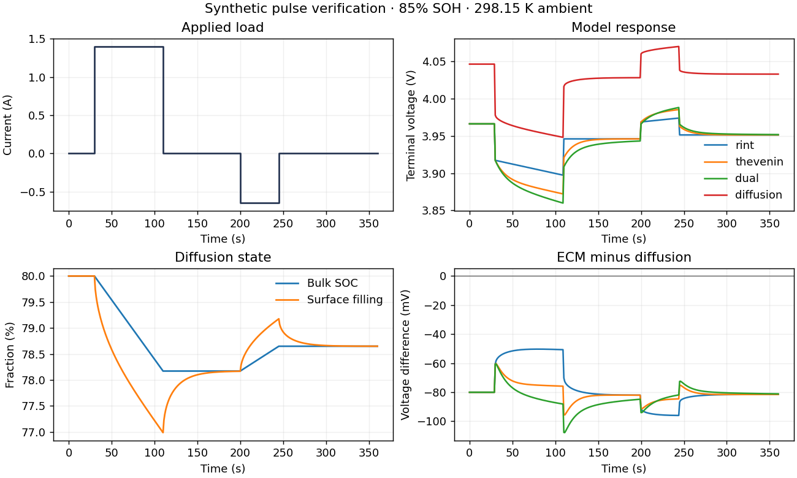

# Synthetic battery modelling v1.1

The synthetic workbench generates seeded battery trajectories for numerical verification and future estimator development. The existing NASA pipeline continues to process experimental discharge data and produce its original Phase 1–4 evidence. Synthetic trajectories are stored under `data/synthetic/` and carry their own provenance. No NASA trajectory is used to calibrate the synthetic cell, and no ECM parameter is inferred from NASA measurements.

## Run and reproduce

Use Python 3.12 and the existing `requirements-lock.txt`. The simulator imports NumPy and uses Matplotlib only when plotting. No dependencies were added. Run these commands from the repository root after creating a virtual environment.

| Task | Linux | Windows PowerShell |
|---|---|---|
| Create environment | `python3.12 -m venv .venv` | `py -3.12 -m venv .venv` |
| Install | `.venv/bin/python -m pip install -r requirements-lock.txt` | `.\.venv\Scripts\python.exe -m pip install -r requirements-lock.txt` |
| Launch the synthetic batch workbench | `.venv/bin/python synthetic_battery.py` | `.\.venv\Scripts\python.exe synthetic_battery.py` |
| Run synthetic verification | `.venv/bin/python -m unittest discover -s tests -p test_battery_sim.py -v` | `.\.venv\Scripts\python.exe -m unittest discover -s tests -p test_battery_sim.py -v` |

The default launch writes one compressed NPZ per model for a 360 s pulse-and-rest scenario sampled at 1 Hz. The default seed is 41. Use `--profile mixed` for variable loads or `--profile rest` for equilibrium. For example, append `--profile mixed --soh 0.72 --ambient-k 283.15 --resistance-scale 1.4 --initial-soc 0.65 --seed 42 --noise-scale 1.2`. Use separate `--output` directories to retain multiple configurations for the same profile and model. Running again with the same output path replaces that scenario's archive.

Append `--figure reports/synthetic/pulse.png` to render the four-panel plot. The plot uses the truth from the selected scenario and requires all four models. `--model diffusion` generates just the diffusion case. The CLI runs offline after installation. For an arbitrary current profile, call `battery_sim.simulate(time_s, current_a, cell, model)` with NumPy-compatible arrays. The configuration recorded by the CLI is embedded in each archive so there is no separate data manifest.

## Conventions and sampling

| Quantity | Definition and units |
|---|---|
| Time and applied current | Seconds and amperes. Positive current discharges, negative current charges. The current at sample k is held until sample k+1. |
| SOC | Remaining available charge divided by available capacity, a fraction. ECM SOC is a uniform state. Diffusion SOC is the mean filling over the slab. |
| SOH | Available capacity divided by nominal fresh-cell capacity, a fraction. It is constant within each scenario and configurable between scenarios. |
| Capacity | Coulombs in the solver and dataset. The `Cell.nominal_ah` input is in Ah and is converted using 3600 C/Ah. Default nominal capacity is 2 Ah and default SOH is 0.85, giving 6120 C. |
| Voltage and temperature | Terminal voltage in volts and lumped cell temperature in kelvin. Ambient and initial cell temperature are equal. |
| Equivalent parameters | Resistances in ohms, capacitances in farads, thermal capacity in J/K, and cooling coefficient in W/K. Diffusion rate is in inverse seconds for a unit-length slab. |

Voltage at each sample is calculated with that sample's new current and the state reached from previous samples. The last current sample affects voltage only. All RC branches start relaxed and all diffusion volumes start at the initial SOC. Currents are ideal step inputs with unit Coulombic efficiency. Profiles that drive bulk SOC or sampled local diffusion filling outside the admissible range are rejected, apart from floating-point tolerance. The solver includes no voltage cutoff or charger logic.

The Rint, Thevenin and Dual Polarisation circuits share one solver with zero, one and two RC branches respectively. For constant current over an interval of duration Δt, SOC decreases by IΔt/Q. Each branch voltage updates to `I R + (v_previous − I R) exp(−Δt/(R C))`. Terminal voltage is the analytic open-circuit voltage at bulk SOC minus the instantaneous `I R0` and the branch voltages. A scenario resistance multiplier scales all resistances. Only R0 further changes with temperature, through `exp(0.018 (298.15 − T))`. The lumped thermal state obeys `Cth dT/dt = P − h(T − Tamb)`. The solver uses the exact constant-power update with power evaluated at the start of the interval. ECM heat includes series-resistance heating. RC losses, entropic heat, hysteresis and explicit ageing kinetics are outside this model.

## Independent synthetic plant

The diffusion model solves linear diffusion on a unit-length slab with a reflecting left boundary and a current-driven flux at the right boundary. A conservative finite-volume discretisation injects `−N I/Q` into the last of N control volumes. Modal integration is exact for the discretised linear dynamics under held current, including the zero eigenvalue that enforces charge conservation. Terminal voltage uses a different analytic open-circuit curve evaluated at the outermost control-volume average, an ohmic drop and a symmetric Butler–Volmer activation drop. Heating includes series and activation contributions. Diffusion, voltage relaxation and local concentration gradients arise without an RC circuit. There are no physically defined R1, C1, R2 or C2 labels for this model.

The plant exercises structural mismatch while retaining known inputs and controlled truth. It shares sign conventions, charge accounting and a simple series-resistance law with the ECMs. Its curves are illustrative. It omits electrolyte gradients, distinct positive and negative electrodes, nonlinear diffusion, side reactions and spatial thermal gradients. It offers no experimental validation of a cell chemistry or estimator.

PyBaMM was reviewed as a separate higher-fidelity path. Its Doyle–Fuller–Newman model resolves solid and electrolyte transport with electrode kinetics. It is a stronger follow-up test for structural mismatch, with additional solver and parameterisation dependencies. The v1.1 plant uses the NumPy-based finite-volume model to keep the default workflow lightweight and offline. Before claiming higher-fidelity verification, run a pinned PyBaMM version in a separate environment with a documented chemistry parameter set, mesh and time-step checks. Map only defendable observables such as terminal voltage, applied current, cell temperature and a declared charge-based SOC reference. Parameter labels must retain the definitions of their generating model. [PyBaMM documentation](https://docs.pybamm.org/en/stable/source/examples/notebooks/models/DFN.html)

## Dataset contract

| Channels | Interpretation |
|---|---|
| `time_s` | Shared sample time. |
| `truth_current_a`, `truth_voltage_v`, `truth_temperature_k`, `truth_soc`, `truth_soh` | Known applied input and simulated physical truth. Truth SOC and SOH are labels or evaluation targets. |
| `truth_polarisation_*_v`, `truth_surface_fraction`, `truth_activation_drop_v` | Model-specific internal states for diagnostics. |
| `measured_current_a`, `measured_voltage_v`, `measured_temperature_k` | Synthetic sensor readings. Independent, zero-mean Gaussian noise uses a PCG64 generator. Default standard deviations are 15 mA, 3 mV and 0.12 K. Noise never feeds into the generating plant. |
| `ref_available_capacity_c`, `ref_r0_ohm`, model-specific `ref_r*_ohm` and `ref_c*_f` | Known, derived model references from the generator configuration and state. Reserve for diagnostics, oracle studies and appropriately split supervised targets. |
| `metadata_json` | Scalar JSON string with schema version, model, parameters, seed, noise scales, operating segments and NumPy version. |

Open archives with `numpy.load(path, allow_pickle=False)`. Release the archive using a context manager. v1.1 produces no estimator output. Future estimates should use an explicit `estimated_` prefix and separate result storage. Reports should identify the dataset family, generator, scenario and split. Float-level differences across BLAS builds and platforms are possible even with the same seed. Gaussian noise is an illustrative sensor model and does not reproduce bias, drift, quantisation or correlations.

## Verification

The default pulse shows the expected immediate ohmic voltage drop, RC relaxation and diffusion recovery. Diffusion bulk SOC ends near 0.78648 and cell temperature peaks near 298.256 K. Twelve-, 24- and 48-volume runs differ from the 96-volume surface trace by at most 0.001349, 0.000586 and 0.000197 in filling fraction respectively. The default 24-volume mesh is sufficient for the verified example under the 0.001 fraction criterion. Other operating profiles require their own convergence checks.

Tests cover zero-current equilibrium, charge conservation and sign, capacity degradation, temperature-dependent resistance, exact RC step and relaxation responses, a closed-form heating and cooling example, diffusion refinement, feasibility checks and reproducible isolated sensor noise. Pulse voltage RMSE against diffusion was approximately 77.7 mV for Rint, 80.7 mV for Thevenin and 83.6 mV for Dual Polarisation. These values measure disagreement between uncalibrated generators. The OCV curves differ and the experiment cannot isolate dynamic error or rank estimators by SOC accuracy.

## Cloud performance and delivery

Measured on Linux x86-64 with Python 3.12.14, NumPy 2.2.6 and an Intel Xeon Platinum 8573C. The cloud process could see five logical CPUs and had a four-CPU cgroup quota. These are cloud measurements. Windows commands are documented for PowerShell and were not exercised in this run.

| Item | Measurement |
|---|---|
| Core repository | About 2.06 MB of tracked working files, including documentation and published figures. The local Git database used about 2.14 MB before the feature commit. Raw data, generated outputs and the environment are excluded. |
| Source files | 25 tracked Python, HTML, Node CJS and PowerShell files, including tests. |
| Dependencies | Zero added. The existing full research virtual environment occupied 480.7 MB of allocated space, measured with GNU `du -sB1 .venv`. |
| Default archives | 85,947 bytes for four 361-sample pulse archives. The mixed-profile set totalled 92,137 bytes. A repeat of the default CLI run produced byte-identical archives on this machine. |
| Figure | 134,299 bytes for the four-panel PNG. |
| Numerical simulation | Warm median for 50 calls per model, timed in-process with `time.perf_counter()` around `simulate(t, i, cell, model)` on the default 361-sample pulse. Rint 2.68 ms, Thevenin 4.97 ms, Dual Polarisation 5.59 ms and diffusion 16.86 ms. |
| CLI runtime and resources | Five fresh subprocesses per mode. Default generation including import and compression took 0.208 s median wall time, 0.703 CPU-seconds mean and 26.0 MiB peak RSS. With a warm Matplotlib cache and PNG export it took 1.081 s median wall time, 1.672 CPU-seconds mean and 62.5 MiB peak RSS. Measured from process launch to exit with `time.perf_counter()`, plus child user/system CPU time and maximum RSS from Linux `resource.getrusage`. |
| Interactive startup, latency and idle memory | Pending an interactive workbench implementation. The batch CLI exits after writing its outputs. |

The full Python suite discovered 40 tests after regenerating the NASA baseline, window outputs and dashboard. Twenty-eight passed, including all eight synthetic tests. Twelve existing integration checks skipped because Phase 2–4 experiment artifacts were absent. The NASA baseline processed 636 discharge cycles with no rejected cycles. The existing Node dashboard smoke test passed 672 control combinations, plus replay, prediction history and forecast visibility checks. For the synthetic-only command, see the installation and reproduction table above. For the NASA commands, see the [original reproduction guide](VERIFICATION.md).
